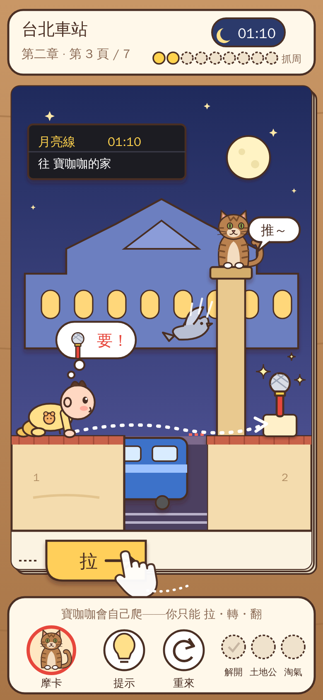
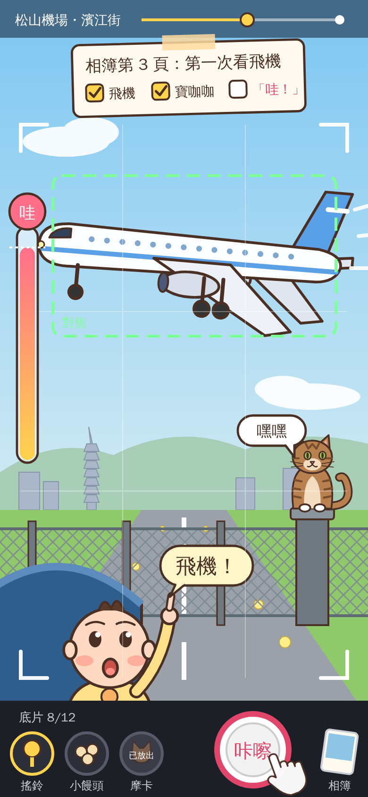
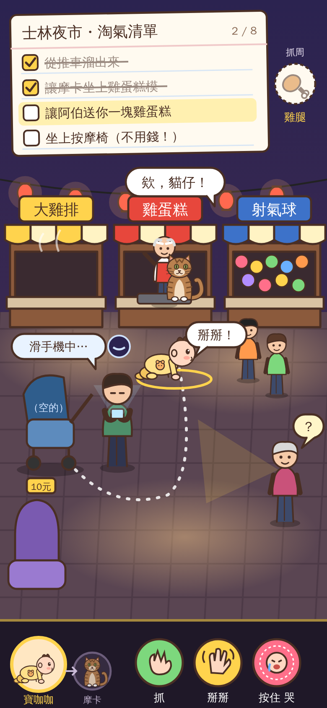

# 寶咖咖 × 摩卡 — Three Fresh Game Concepts

**Status:** Concept pitch, v1 (2026-10-18). This document starts from a clean slate. It assumes **nothing** from the current isometric RPG (`src/quest/`, the 仙劍-style spec). No command battles, no shops, no inns, no random encounters, no levels or stats.
**Mocks:** `docs/design/mocks/*.png` (a 390×844 phone-portrait viewport, saved at 2× = 780×1688). Sources are in `docs/design/mocks/src/`; re-render with `PLAYWRIGHT_BROWSERS_PATH=/opt/pw-browsers node docs/design/mocks/src/render.mjs`.
**Story source:** the story bible (`docs/story/story-bible.md`) is treated as a parts bin. Each concept says what it keeps.

---

## 0. Where I started

Before writing any concepts, I asked one question: **what is actually delightful about a one-year-old and a tabby cat?** The answer is not "they fight monsters." It's this:

1. **A toddler cannot be controlled.** He goes where *he* wants. He wants the shiny thing, the cat and the snack, in roughly that order. Every parent has spent a year redirecting a crawling baby. That's a game.
2. **A toddler is a tiny scientist.** He grabs everything, puts it in his mouth, drops it to see what happens, and says 「哇！」 when the world does something. Poke → reaction is the most primal toy loop there is.
3. **A cat is a gentle agent of chaos.** Mocha squeezes through gaps, sits on things you need, knocks things off tables while keeping eye contact, and appears in every photo uninvited.
4. **Families photograph everything.** The baby's first year *is* a phone full of photos: first time seeing a plane, first night market, first 101. The real-world audience of this game (the family) already plays this "game" every weekend.
5. **Words are milestones.** Baokaka knows about twelve words. Each new word is an event the whole family celebrates. That's a progression system nobody has to explain to 阿嬤.

Each concept below builds its core toy on a different one of these truths.

### Shared pillars (all three concepts)

- **One thumb, zero reading to start.** The first 30 seconds teach themselves through play. Text is a garnish, never a gate.
- **No fail state that takes anything away.** The worst outcome is a funny animation and a soft reset of a few seconds.
- **Short sessions.** A meaningful unit is 1 to 3 minutes. You can stop at any time and come back to the same spot.
- **Taipei as a toy, not a backdrop.** Every landmark has to *do something* when you touch it.
- **Three generations on one sofa.** Each concept has something for 阿公/阿嬤 (recognition, gentleness), for kids (slapstick, collecting) and for parents (cleverness, nostalgia, in-jokes).

---

## Concept A — 《翻翻台北》 Pop-Up Taipei

> **Hook: You can't steer a baby. You can only rearrange the city.**
> 寶寶不聽指揮——你只能改變台北。

### Genre

A **diorama puzzle-adventure** set inside a pop-up storybook. Think *Monument Valley* meets *Lemmings*, with the tactile pull-tabs of a children's pop-up book.

### Premise (reuses the story bible)

It's the night before the 抓周. The baby typhoon 咻咻 blows the nine treasures out of the window, and they land all over Taipei. 阿嬤's old pop-up book 《台北》 falls open, and Baokaka crawls *into* it. Each landmark is a chapter of the book, and each chapter has 5 to 8 pages. Every page is one puzzle: get Baokaka to the thing he wants. The clock (00:00 to 05:30) is the chapter header and nothing more. It's atmosphere, not a timer.

### The core toy

**Baokaka moves on his own.** He crawls (steadily, at a comical pace) toward whatever he wants most *that he can see*. You never touch him directly. Instead you **manipulate the paper world**:

- **拉 Pull-tabs** slide parts of the scene (an MRT car slides across a gap and becomes a bridge).
- **轉 Paper wheels** rotate things (the eight sections of 101 turn like a combination lock).
- **翻 Flaps** lift to reveal or hide things (hide a treasure, and he loses interest; show Mocha, and he changes course).
- **摩卡 Mocha is your one "piece."** Tap a spot and Mocha hops there, following cat rules (see below).

His desire follows a simple, readable priority. Each item has an icon in a thought bubble over his head, so you can always *see* what he's thinking:

| Priority | Want | Bubble | He says |
|---|---|---|---|
| 1 | The 抓周 treasure / anything shiny | sparkle | 「要！」 |
| 2 | Mocha | cat face | 「喵喵！」 |
| 3 | Snacks (milk, 小饅頭) | bottle | 「ㄋㄟㄋㄟ」 |
| 4 | Lights and noise | music note | 「哇！」 |

**He is never in danger.** At an edge he stops, sits down and claps (「不要！」). If he can see nothing he wants, he **cries**: 「哇——」. The cry is not a failure, it's a **tool**. It's a sound wave that wakes sleeping things: pigeons scatter, a dozing guard opens a gate, the lights of 西門町 snap on. Some of the best puzzles are about making him cry *on purpose* by hiding everything he likes.

### Toddler-ness as mechanics

- **Autonomy = the whole puzzle.** Children's "logic" (shiny > cat > snack) is the rule set. Parents will laugh in recognition.
- **New words = new verbs.** The twelve words are the progression system. Each chapter's treasure teaches one word, and each word changes how he interacts with the world:
  - 「掰掰」: he waves, and people and animals wave back and step aside.
  - 「抱抱」: he raises his arms, and the nearest adult (or 黑熊) picks him up and carries him one step. That's an "elevator."
  - 「嗶！」: he imitates the MRT gate, and gates open.
  - 「不要！」: he turns around and crawls the *other* way. It's a reversal, which suits the toddler perfectly.
  - 「飛機！」: he points up, and everything with wings looks up too.
- **Motor milestones = movement upgrades:** crawl → **扶著站** (cruising along furniture, so he can reach a shelf) → **爬樓梯** (one step up) → finally, on the roof of 101, the **first steps**. Walking lets him cross a one-tile gap, and the music swells. The finale's puzzle can only be solved by walking.

### Cat-ness as mechanics

Mocha is placed by tapping. He follows real cat rules:
- **Likes high places.** He can only perch on ledges, rooftops and shelves (never in the middle of the floor).
- **擠 Squeezes** through any gap his head fits through, so he reaches pull-tabs on the far side.
- **推下去 Knocks things off.** When he's placed next to an object on a ledge, he pushes it off while looking at you. That starts dominoes.
- **坐在上面 Sits on things.** A cat sitting on a pull-tab locks it in place.
- **Lure.** He is Baokaka's priority-2 desire, so where you put Mocha is where the baby goes (unless something shinier is visible).

### Taipei landmarks as paper toys

| Landmark | The toy |
|---|---|
| 台北車站 | The split-flap departure board flips to *reroute* paper train cars. The checkered hall floor is a sliding-tile puzzle. |
| 捷運 | Cars are slide-in platforms. The "嗶" gates. The 博愛座 (priority seat) is the only safe seat. |
| 台北101 | The eight stacked sections rotate like a combination lock. The tuned mass damper is a giant pendulum you push to swing him across. |
| 龍山寺 | Flip the 筊杯: 聖筊 opens the gate, 笑筊 makes the stone lions giggle and move. |
| 西門町 | The 紅樓 octagon rotates. A claw machine's claw is a crane that picks up the baby. |
| 士林夜市 | Rotating skewers on the grill, and a game booth where popping balloons drops prizes onto paths. |
| 松山機場 | The baggage carousel is a conveyor belt. A jet bridge extends and retracts. |
| 貓空纜車 | Gondolas on a pulley wheel you crank. Tea terraces are steps. |
| 碧潭 | Pedal the swan boat (rotate the wheel) to make a moving island. |
| 北投 | Steam vents lift paper clouds as elevators. Mocha refuses to go near the hot spring water. |
| 陽明山 | Fog flaps reveal and hide the path. A 水牛 (water buffalo) is a moving platform that only moves when it hears 「掰掰」. |
| 淡水 / 淡江大橋 | The bridge's single tower and cables are harp strings: pluck them to send birds or ferries. Sunset gradually turns the paper gold. |

### Core loop

- **Second to second:** watch where he wants to go → pull, turn or flip something → he changes course → giggle.
- **Minute to minute:** one page = one puzzle, 1 to 3 minutes. Solve it → the page "pops" to the next one with a satisfying paper-fold animation and sound.
- **Session to session:** a chapter (one landmark, 5 to 8 pages, about 15 minutes) ends on a big two-page spread where he grabs the treasure, learns a word, and you get a pop-up "photo" for the 抓周 album.

### Progression and replayability

- 9 chapters (one per treasure) plus a prologue and the 101 finale: about **70 pages**, roughly 3 to 4 hours.
- **Three stickers per page:** 解開 (solved), **找到土地公** (a hidden 阿伯 on every page), and **淘氣** (an optional mischievous goal, such as "make Mocha knock the 雞排 off the counter").
- **Pop-up album:** every chapter's ending spread is kept as a playable, pokeable diorama in 阿嬤's book.
- A post-game "**倒著讀**" (read the book backward) mode remixes pages with walking unlocked.

### What each generation enjoys

- **阿公/阿嬤:** It's a picture book. There's no timer and no reflexes. They recognize 龍山寺's 筊 and the 101 damper. Watching the baby crawl is pure joy.
- **Kids:** Pulling tabs is tactile and funny. The baby crying wakes everything up. Mocha knocking things off.
- **Parents:** Real "aha" puzzles with clever priority logic, plus the in-joke that *you cannot control a toddler*.

### A 60-second play moment (台北車站, page 3)

> The page opens with a *fwump* of paper. Baokaka sits on the left platform, the 麥克風 glitters on the right one, and between them the track pit is a paper gap. His bubble shows a sparkle: 「要！」 He crawls happily to the edge, stops, plops down on his bottom and claps: 「不要！」 He's not going to fall. You see a pull-tab poking out of the page's bottom edge. It says 「拉」. You drag it, and a blue paper train slides in from the left. It's not quite long enough, and there's still a gap. Hmm. You tap the pillar above the gap. Mocha bounds up there, sees a paper pigeon perched on the ledge, and looks you in the eye as he slowly pushes it off. The pigeon flaps down and lands on the train's back coupling. Its wings spread and cover the gap. Baokaka sees Mocha on the pillar (bubble: cat face), changes his mind about the microphone, and crawls across the train toward the pillar. 「喵喵！」 Halfway across, the microphone catches the light again (sparkle!). He swerves, grabs it, and stuffs it straight into his mouth. The microphone squeaks out 「嗶——」 and the paper train toots back. The page folds up. **Sticker: 解開.** (There was a 阿伯 hiding behind the departure board. You'll come back for him.)

### Scope and feasibility (existing web stack)

- **Engine:** deterministic, tile- or node-based simulation (Baokaka is a pathfinding agent on a small graph of walkable nodes, and props are state machines). It's very testable with Vitest and easy to verify with headless "solution replays."
- **Rendering:** each page is a layered SVG diorama with CSS transforms for tabs, wheels and flaps (paper "pop" via `scaleY` + shadow). The paper style forgives simple shapes. It's arguably the *cheapest* art style to look polished.
- **Effort (one dev plus AI pair):** engine and editor tooling **3 to 4 weeks**; then about **1 day per page** of design, art and tuning (70 pages ≈ 10 to 12 weeks). A charming vertical slice (prologue + 台北車站, 10 pages) takes about **5 weeks**.
- **Risk to watch:** level design is the product. Puzzles must be hand-tuned and playtested with a non-gamer.

### Risks

- **Indirect control may frustrate kids at first.** Mitigation: the first five pages have only one interactive thing, and there's a 「提示」 that shows a ghost hand.
- **Puzzle content is labor-intensive.** Mitigation: a page editor (JSON + live SVG preview) from week 1, and a "remix" system for post-game pages.
- **Can feel cerebral.** Mitigation: every interaction gets a joke animation, even wrong ones.

---

## Concept B — 《咔嚓！寶咖咖的第一本相簿》 Snap! Baby's First Album

> **Hook: Ride Taipei's best family outings and snap the perfect "first." The city keeps photobombing.**
> 推著嬰兒車拍照——每一張都是「第一次」。

### Genre

An **on-rails photo safari**, in the spirit of *Pokémon Snap*, *Alba* and *Umurangi Generation*, made tender. It is the gentlest of the three concepts.

### Premise (a different take on the bible)

It's the week before Baokaka's first birthday. 阿嬤 wants a **生日相簿** for the 抓周 party: twelve pages, each one a "first." The family's phone is full of blurry photos, mostly of the floor. Mocha (who resents that 「大家手機裡都是你的照片」) is secretly the narrator. Each outing is a ride around one Taipei landmark, and your job is to get *the* shot. In this version, the 抓周 treasures are album "stickers" earned by the best photos. 咻咻, the baby typhoon, becomes a playful *weather* that appears in rides (wind gusts make balloons, umbrellas and hats fly, so you get chaos shots) until the final page, where you finally photograph it smiling.

### The core toy

You're moving through Taipei on a fixed path: **Dad pushing the stroller**, then the 捷運 front window, the 貓空纜車, a 天鵝船, the 101 elevator, a riverside bicycle child seat, the 淡水 ferry. Each ride lasts 90 seconds to 3 minutes. Your thumb:
- **Drag** to look around (or tilt the phone, if gyro permission is granted).
- **Tap** the big shutter. You have 12 shots per ride (old-school film counter, 「底片 8/12」).
- **Throw** things from the tool tray to *make moments happen*:
  - **搖鈴 Rattle:** everyone in frame (people, pigeons, the 101 cleaning 阿伯) turns to look at the camera.
  - **小饅頭 Puffs:** lure pigeons, ducks, koi and squirrels into frame.
  - **摩卡 Mocha:** release the cat. He pounces and scares birds into a beautiful takeoff, or photobombs from a corner.

**Baokaka is always in the shot.** He's in the stroller or carrier in the foreground, and his face reacts in real time. Point the camera at something he loves, and his reaction meter fills: a little 「哇！」 bubble, then a giant one. A photo with a **big 「哇！」 face plus the subject** is gold.

### Photo scoring (by the family, not a number)

Each photo is "reviewed" by family members, who each have tastes (a hidden multi-criteria score shown as a comment and red stickers):
- **阿嬤:** Is Baokaka's face visible and happy? (「乖孫笑得好可愛！」)
- **阿公:** Is the landmark centered and level? (「101 要拍整支啦。」)
- **爸爸:** Planes, trains, anything with an engine. (「這架是 A321！」)
- **媽媽:** Timing and emotion (mid-sneeze photos count as legendary).
- **摩卡:** Is Mocha in it? (He gives every photo without him zero, with a sulky 「……喔。」)

Each ride has an **album request card** with three goals, such as: 「第一次看飛機：飛機＋寶咖咖＋哇！」 Hitting the gold requirement unlocks a 抓周 sticker for the album page.

### Toddler-ness and cat-ness as mechanics

- **The 「哇！」 reaction meter** is the heart of the scoring. Learning what makes *this* baby happy (planes > Mocha > bubbles > dogs > 阿伯's beard) is the "depth."
- **Toddler unpredictability:** he yawns, sneezes, grabs the camera strap (a quick tap minigame to free it), drops a sock (it becomes a running photo subject), and falls asleep near the end of long rides. A sleeping-baby shot is its own secret category.
- **Words as collectibles:** the first time he reacts to a new thing, he says a new word on camera: 「飛機！」「ㄅㄚ！」 (101), 「嗶！」. The album records which word was learned on which page.
- **First steps:** the final ride is not on rails. It's a short walk across the 101 observation deck. It's the one ride where *Baokaka* moves, wobbling toward Mocha, and you must catch it on camera.
- **Mocha:** the "chaos button" and recurring photobomber. Hidden Mocha cameos on every ride (in a window, on a roof, in a gondola going the other way) are a collectible set: 「摩卡在哪裡」.

### Taipei landmarks as playful spaces

| Ride | Moment generator |
|---|---|
| 松山機場 濱江街 runway end (stroller) | Planes land overhead on a schedule. Dramatic low pass plus big 「哇！」 = page "第一次看飛機." |
| 文湖線 front window | The driverless train's front view: tunnels, curves and the 101 reveal. |
| 貓空纜車 | Glass-floor gondola. Look down for tea farms, the zoo's pandas, other gondolas. |
| 碧潭天鵝船 | Pedal-boat: ducks, the suspension bridge, a dragon-boat crew practicing. |
| 士林夜市 (carrier) | Steam, neon, food stalls. Lure the stall cat. The game booth's balloons pop (chaos shot). |
| 台北101 elevator → deck | 37-second elevator ride with an altitude meter, then the deck. Forced-perspective goal: 「寶咖咖捏住101」 from the 象山 trail. |
| 龍山寺 | Incense smoke swirls (咻咻 hides in it), pigeons, the 筊 throw. |
| 大安森林公園 | Squirrels, the bubble man, the music stage. |
| 淡水 ferry → 漁人碼頭 | Sunset. The 淡江大橋 tower catches the light. A golden-hour bonus. |
| 北投 | Steam, the hot-spring museum, the old 新北投 train. |
| 陽明山 | Calla lilies at 竹子湖, fog that rolls in and out, the 擎天崗 water buffalo. |
| 西門町 | Street dancers, the 紅樓, a cosplayer. |

### Core loop

- **Second to second:** look, aim, wait for the moment, snap.
- **Minute to minute:** a ride is 1 to 3 minutes with 12 shots. Afterwards there's the family review: everyone's comments, stickers, and the best shot placed in the album.
- **Session to session:** the album fills up (12 pages + secret pages). New tools unlock (rattle → puffs → Mocha → bubble wand → toy plane). Replaying a ride with new tools reveals new moments (Pokémon Snap's genius loop).

### Progression and replayability

- 12 rides, each with 3 tiers of goals, a hidden Mocha, a hidden 土地公 and a secret moment (e.g., at 碧潭 a swan boat with a couple proposing, if you lure ducks to spell a heart).
- **Weather and time variants** (sunny, rainy, golden hour) change what appears; 咻咻 brings wind gusts.
- **The album itself** is the trophy, and it's shareable. Families could screenshot pages.
- **A parent-only feature (later):** import a *real* photo as the album cover.

### What each generation enjoys

- **阿公/阿嬤:** The simplest controls of the three (look and tap). Real Taipei outings they've taken. Grandma's critiques are about the baby's smile, so they "win" by doing what they already love.
- **Kids:** Throwing puffs, releasing the cat, chaos shots, finding hidden Mocha.
- **Parents:** Composition, timing, the deeper multi-critic scoring, nostalgic recognition ("we did this exact 松山機場 thing").

### A 60-second play moment (松山機場, 濱江街)

> The ride begins. Dad pushes the stroller along the fence at the end of the runway. Baokaka's chubby hands grip the stroller bar in the bottom of your frame. The request card slides in: 「第一次看飛機：飛機＋寶咖咖＋哇！」 Far away, a tiny light: landing lights. The baby hasn't noticed; he's chewing his sock. You throw the rattle. Baokaka looks up just as a white jet roars low overhead. The 「哇！」 meter rockets up. *Click.* Too early, the plane is only half in frame. *Click.* Better. Then Mocha, who you released twenty seconds ago, hops onto the fence post in the corner of the frame with his tail up. The meter hits max, the baby's mouth is a perfect O, and he points: 「飛機！」 *Click.* The screen freezes for a beat with a flash of white and a gentle shutter sound. Review: 爸爸: 「起落架都拍到了！」 阿嬤: 「乖孫嘴巴開開～」 摩卡: 「……不錯。我在裡面。」 Three red stickers. A new word goes into the album: 飛機.

### Scope and feasibility

- **Engine:** a rail is a parametric path through 2.5D parallax layers (SVG/CSS transforms in a `<canvas>` or DOM). Moments are scripted timelines with a few reactive triggers (tool hits). The photo is computed from what's in the frame rect (bounding boxes, centeredness, facing, the 哇 value), and the shot is captured by re-rendering the frame to a bitmap for the album.
- **Art:** heavy on *scenery*. Each ride needs a lovingly drawn parallax panorama, so this is the most art-intensive per minute of play, but the elements reuse well (pigeons, planes, people).
- **Effort:** engine + scoring + album **3 weeks**; then about **4 to 6 days per ride** (12 rides ≈ 10 to 12 weeks). A vertical slice (松山機場 + 大安森林公園) takes about **5 to 6 weeks**.

### Risks

- **Depth.** Photo games can feel thin after the first playthrough. Mitigation: tool-unlock replays, secret moments and multi-critic scoring.
- **Performance** of large parallax panoramas on older phones. Mitigation: bake layers to bitmaps at build time, and keep only light effects at runtime.
- **The camera is passive.** Mitigation: the tools make the player an active "moment director," not a spectator.

---

## Concept C — 《推車大逃脫》 Stroller Break!

> **Hook: Every time Dad looks at his phone, a baby and a cat escape the stroller and cause gentle chaos across Taipei.**
> 爸爸一滑手機，寶咖咖和摩卡就溜出推車，在台北搗蛋。

### Genre

A **sandbox mischief game** in the vein of *Untitled Goose Game*: small open landmark playgrounds, a to-do list of silly goals, multiple solutions, and comedic stealth-lite.

### Premise

It's the day before the 抓周. The whole family goes around Taipei to buy the nine 抓周 items (阿嬤's list: 蔥, 書, 印章, 麥克風…). But Baokaka has his own ideas about what a one-year-old needs, and Mocha (who snuck into the stroller basket) is his accomplice. In each landmark the family is busy (Dad on his phone, 阿嬤 bargaining, Mom queuing for 雞蛋糕), and the two escape to complete their **淘氣清單** (mischief list). The final item on every list is always the same: get the treasure *Baokaka* thinks belongs on the 抓周 tray. (At the party, after all that, he grabs… Mocha.)

### The core toy

You control **one of the two at a time** (tap their portrait to swap; the other waits or follows):
- **Tap the ground** to crawl/walk there (pathfinding).
- **Tap an object** to do the contextual thing.
- **Hold on Baokaka** to cry: a big ring that every adult within range responds to.

The **world is full of small simulated systems** that react to each other: vendors, pigeons, balloons, scooters, a 雞排 frying, a dog, a massage chair, an MRT gate, the night-market game booth. Each to-do item can be solved in more than one way.

**The family are the "guards."** Each adult has a soft vision cone and a state:
- 滑手機 (on phone, oblivious)
- 東張西望 (looking around)
- 看到了！ (spotted you)

If an adult reaches Baokaka, they scoop him up — 「抓到了～小壞蛋」 — and put him back in the stroller (the checkpoint). He wriggles out again a few seconds later. **Nothing is lost.** Completed to-dos stay completed.

### Toddler-ness as mechanics

- **爬 Crawling** is slow but low: under tables, between legs, through 夜市 crowds unseen.
- **抓 Grab** anything that fits in his hand, which usually goes into his mouth first (a squeaky toy squeaks *in* his mouth, a 雞腿 goes 啃啃).
- **丟 Throw:** he drops whatever he's holding to see what happens. (Pigeons rush in for food. Balloons float up.)
- **哭 Cry (hold):** every adult in range rushes over. Strategic crying draws the vendor away from his stall!
- **掰掰 Wave / 可愛 Cute:** adults who see him melt — 「好可愛喔～」 — and give him something (a 雞蛋糕, a balloon, a sticker). Cuteness is a currency.
- **First steps:** the midpoint powerup. **扶著站** (cruising) lets him reach countertops; walking (end game) is faster but wobbly, with a funny fall-on-bottom every few steps.

### Cat-ness as mechanics

- **跳 Jump** onto counters, shelves, roofs, and the tops of the claw machine.
- **鑽 Squeeze** through gaps, bars and fences that block everybody else.
- **推下去 Knock off:** any object on an edge can be pushed off, slowly, while maintaining eye contact (a 1-second tension animation). Things fall into baskets, onto conveyors, onto heads.
- **討摸 Flop for pets:** he rolls over in front of an adult, who stops whatever they were doing to pet him for 5 seconds. It's a perfect distraction.
- **Hates water:** puddles and fountains are walls for Mocha only.

### Taipei landmarks as playgrounds (each a compact map with 8 to 10 to-dos)

| Landmark | Sample to-dos |
|---|---|
| 士林夜市 | 讓阿伯送你一塊雞蛋糕 · 坐上按摩椅 · 把射氣球攤的氣球全部放飛 · 被網紅直播拍到 · 抓到 **雞腿** |
| 台北車站 | 在大廳的地板上爬一圈（大家坐在地上） · 讓廣播姊姊說「寶咖咖」 · 嗶進閘門 · 抓到 **印章**（便當店的） |
| 大安森林公園 | 和松鼠交換食物 · 把泡泡阿伯的泡泡戳破十個 · 讓跳舞阿姨們跟著你拍手 |
| 龍山寺 | 擲出聖筊 · 讓鴿子排成一排 · 抓到 **書**（解籤詩的） |
| 西門町 | 夾到娃娃機 · 讓街舞哥哥跟你跳 · 抓到 **麥克風**（紅樓旁的街頭藝人） |
| 松山機場 | 坐上行李轉盤繞一圈 · 對飛機說「飛機！」 · 躲進行李車 |
| 台大 | 讓醉月湖的鵝追著摩卡跑 · 坐上腳踏車的籃子 · 抓到 **算盤**（總圖的） |
| 101 | 搭 37 秒的電梯 · 在阻尼球前面學它晃 · the finale: walk across the deck |
| 北投 / 淡水 / 碧潭 / 貓空 (later playgrounds) | 偷泡腳 · 鐵蛋 · 天鵝船 · 纜車 |

### Core loop

- **Second to second:** tap to move, tap to poke, watch systems react, swap characters.
- **Minute to minute:** pick a to-do, form a plan ("Mocha flops for 阿嬤 while Baokaka crawls under the table"), execute it, laugh at what actually happens.
- **Session to session:** each landmark takes about 15 to 25 minutes to clear its main to-dos. A landmark can be played in five-minute chunks (the list remembers your progress).

### Progression and replayability

- 10 landmarks, about 90 to-dos, roughly 5 hours.
- **Bonus to-do lists** unlock after clearing a landmark (e.g., 「速度挑戰」, 「不被抓到」).
- **Emergent comedy:** systems interact unpredictably (a balloon tied to Mocha's tail; a pigeon stealing the sausage that Mocha knocked down). This is the most "replay for fun" concept of the three.
- A **photo mode** screenshots the funniest moment of each landmark for the 抓周 party slideshow.

### What each generation enjoys

- **阿公/阿嬤:** Laughing at Dad being on his phone. The cute-currency (they *are* the adults who melt). But controls are harder for them than in A or B.
- **Kids:** This is *their* fantasy: being the naughty baby, getting away with it, the cat knocking things off tables.
- **Parents:** Clever multi-solution puzzles, painfully accurate satire of parenting in Taipei.

### A 60-second play moment (士林夜市)

> Dad parks the stroller beside the 雞排 stall and starts scrolling. 「滑手機中…」 floats over his head. You tap the stroller: Baokaka slithers out like a seal and plops onto the ground. Tap under the table: he crawls, unseen, between the legs of a queue of students. On the to-do card: 「讓阿伯送你一塊雞蛋糕」. You swap to Mocha. He jumps onto the 雞蛋糕 counter and sits squarely on the mold. The 阿伯 laughs, 「欸，貓仔！」, and comes around to lift him off. While he's out front, you swap back to Baokaka, crawl into view and hold-to-wave: 「掰掰！」 The 阿伯 turns, sees the baby, and melts: 「哎唷～好可愛！來，給你一個。」 A warm 雞蛋糕 drops into Baokaka's hands. Done. Behind you, Dad's eye icon flickers. He's looking up! You hold to cry. Mom rushes over from the 珍奶 line, and while the adults fuss, Mocha tips a cup off the counter. It rolls over to the balloon stand… and the next to-do is already halfway done.

### Scope and feasibility

- **Engine:** real-time top-down (3/4 oblique, not isometric) with pathfinding, NPC state machines, object interactions and a light physics model (falling, rolling). It's the most complex of the three: every to-do is a little systemic interaction to author and test.
- **Art:** characters in many poses (crawl, grab, cry, eat, held by adult; cat jump, flop, push), plus 6 to 10 NPC types per map with states.
- **Effort:** engine + NPC AI + interaction framework **6 to 8 weeks**; then about **2 to 3 weeks per landmark** (10 landmarks ≈ 5 to 7 months). A vertical slice (士林夜市 only) takes about **9 to 10 weeks**.

### Risks

- **The hardest to make *feel* good** on touch: tap-to-move in a busy scene can misfire, and stealth tension can frustrate young kids or grandparents.
- **Biggest scope.** Systemic games need a lot of iteration.
- **Tone.** "Escaping" a parent must stay clearly playful and never model unsafe behavior. Mitigation: the family is always nearby, the "escape" is always within arm's reach, and the end-of-level card shows the family hugging.

---

## Side-by-side

| | A 翻翻台北 Pop-Up Taipei | B 咔嚓！第一本相簿 Snap! | C 推車大逃脫 Stroller Break! |
|---|---|---|---|
| Genre | Diorama puzzle-adventure | On-rails photo safari | Sandbox mischief |
| The toy | Rearranging a paper city around a baby who goes where he wants | A camera, a baby's 「哇！」, and moments you make happen | Two characters poking at a living market |
| Thumb | Drag tabs, turn wheels, tap Mocha | Look + shutter + throw | Tap to move/poke, hold to cry, swap |
| Session unit | 1 page, 1–3 min | 1 ride, 1–3 min | 1 to-do, 2–5 min |
| Grandparent-friendly | ★★★★ | ★★★★★ | ★★★ |
| Kid fun | ★★★★ | ★★★★ | ★★★★★ |
| Adult depth | ★★★★★ | ★★★ | ★★★★ |
| Uses "toddler-ness" | ★★★★★ (autonomy, words, milestones) | ★★★★ (哇, words, naps) | ★★★★ (grab, cry, cute) |
| Uses "cat-ness" | ★★★★ | ★★★ | ★★★★★ |
| Landmarks as toys | ★★★★★ | ★★★★ | ★★★★ |
| Scope to full game | ~3–4 months | ~3–4 months | ~6–8 months |
| Vertical slice | ~5 weeks | ~5–6 weeks | ~9–10 weeks |
| Biggest risk | Puzzle authoring load | Shallow over time | Feel and scope |

---

## Recommendation: build A, 《翻翻台北》 Pop-Up Taipei, and borrow two things from B and C

**Why A:**

1. **It is the only concept where the core mechanic *is* the truth about the star.** "You can't control a toddler, you can only change his environment" is something every parent has lived. It's funny the instant you see it, and it never runs out of jokes, because every new prop is a new way for the baby to ignore you. This is the "Nintendo test": the mechanic and the character are the same idea.
2. **Toddler milestones become a perfect progression system.** New words are new verbs, and crawl → cruise → steps is a movement upgrade path. The finale (he walks for the first time, and you need it to solve the last page) is an emotional moment *delivered through play*, not a cutscene. The owner's real son will reach these milestones; the game can grow with him.
3. **It's the best for three generations at once.** No reflexes, no timer, no fail. A grandparent can pull a tab and watch. A kid can make the baby cry on purpose. A parent can solve the clever pages. And it can be played *together*: one person holds the phone, everyone shouts suggestions.
4. **Landmarks are literally toys.** The 101 combination-lock, the 筊杯 gate, the departure board, the claw machine: each landmark gets its own signature mechanic, which keeps the game fresh across chapters.
5. **It's the most feasible to make beautiful.** Paper craft forgives simple vector shapes, the simulation is deterministic and testable (solution replays in CI), and short pages fit a phone session perfectly. A vertical slice is about 5 weeks.
6. **It keeps the best of the story bible** (抓周, 咻咻 the baby typhoon, the 5:30 deadline, Mocha's jealousy, 阿伯 = 土地公, the first word 「摩卡」) while throwing away everything that made it feel like an RPG.

**Borrow from B:** each chapter's final spread becomes a **photo for the 抓周 album**. Use a mini "snap" moment (tap the shutter as Baokaka grabs the treasure, with a 「哇！」 meter) and family comments. It gives every chapter a warm payoff and a shareable keepsake.

**Borrow from C:** the optional **淘氣 sticker** on every page is a little mischief goal (make Mocha knock something off, make the 阿伯 laugh). It gives kids a "naughty" reason to replay pages, without the scope cost of a full sandbox.

**Suggested first milestone:** a 10-page vertical slice — prologue (the 抓周 tray, 咻咻 blows the treasures away, 3 tutorial pages in the living room) + 台北車站 (6 pages + the 麥克風 spread). Playtest it with 阿嬤 *without explaining anything*. If she laughs when the baby sits down and claps at the edge, we're on the right track.
