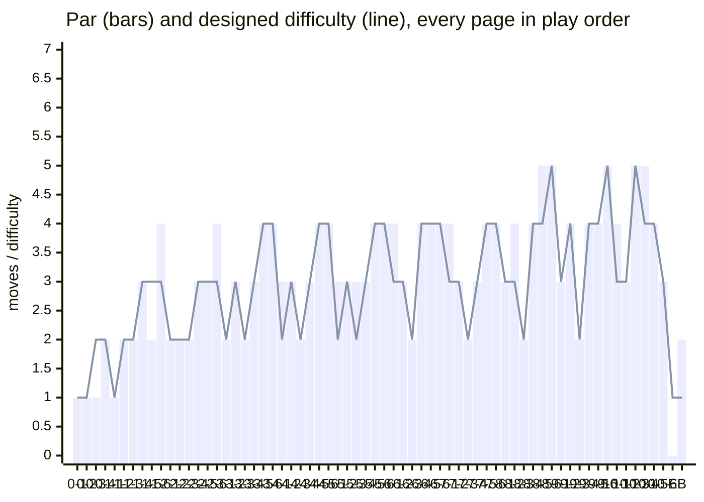
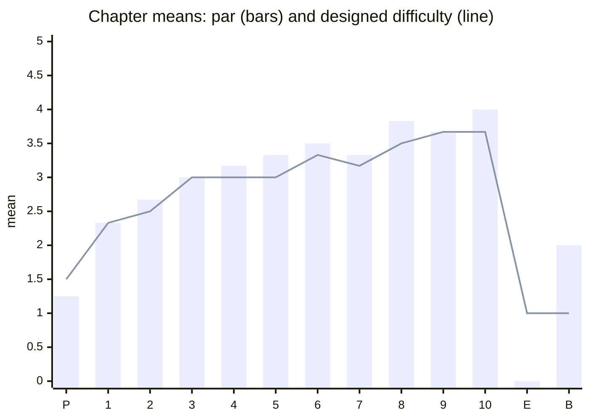

# The difficulty curve

*The whole game measured (#137, 2026-10-22): par, solver states and what each page introduces, against the plan in GDD § 4.2 (≈ 1.5 in the prologue, ≈ 2.3 in chapter 1, ≈ 3.8 by chapter 8, a breather at every page 3, an easy finale) and the band rule in GDD § 3.7 (difficulty 1 → par 1–2, 2 → 2–3, 3 → 3–4, 4 → 4–5, 5 → 5–7). Decision: D-107.*

**Regenerate** the charts and tables below with `npm run solve -- --curve` (it prints this Markdown; paste it over the "Measured" section). `npm run solve` prints the full report (dead ends, soft traps, 淘氣/土地公, lint), and `pages.test.ts` proves the same on every `npm test`.

## Verdict

- **Every page is proven.** 66 pages (65 + the bonus page): lint clean (0 errors, 0 warnings), the authored solution replays to `done`, a complete solve, **0 dead ends, 0 soft traps, no walkable decoy, no visible tie**, 淘氣 and 土地公 reachable on every page; page E alone is trivial (allowed). Two pages sit outside their band, both on purpose (below).
- **The curve follows the plan.** Chapter means of par: prologue 1.25 (difficulty 1.50), chapter 1 2.33 (2.33), then a steady climb to 3.83 in chapter 8, a plateau through chapter 9 (3.67) and a climax in chapter 10 (4.00), then the easy finale: 10-6 par 3, page E par 0, the bonus page par 2. Every page 3 is a breather (par 2; 5-3 par 3) except 10-3, by design (below).
- **One page tuned:** 9-2 「淡水老街」 was chapter 9's spike, par 5 in a page-2 slot (as hard as the spread, harder than 9-4 and 9-5). Mocha now waits on the 鐵蛋 shop's sign from the start, so the page opens on the walk and its change of mind: par 4 (in band for its difficulty 4), 6,479 → 1,742 states. The aha (one shutter down to hide the 招財貓, one up to show the bead) is untouched.
- **Cost.** 185,597 solver states for the whole book, 44 % of the 420,000-state CI budget (D-98); ≈ 19 s on this machine. The largest page is 8-6 (37,494 states, 20 % of the suite). No page is near the 2,000,000-state cap (the largest is 1.9 % of it).
- **Hints.** 提示 at level 3 finishes every page from the start, from every state one move away, with the solver and with the stored-solution fallback alone (#100), and now also from **20 wandered states per chapter** (seeded random play, 1–10 moves deep; `hints.test.ts`): 0 stuck.

## Measured

| Chapter | Pages | Mean difficulty | Mean par | Pars in order | States |
|---|---|---|---|---|---|
| P | 4 | 1.50 | 1.25 | 1 · 1 · 1 · 2 | 240 |
| 1 | 6 | 2.33 | 2.33 | 1 · 2 · 2 · 3 · 2 · 4 | 1,259 |
| 2 | 6 | 2.50 | 2.67 | 2 · 2 · 2 · 3 · 3 · 4 | 1,142 |
| 3 | 6 | 3.00 | 3.00 | 2 · 3 · 2 · 3 · 4 · 4 | 14,928 |
| 4 | 6 | 3.00 | 3.17 | 3 · 3 · 2 · 3 · 4 · 4 | 21,522 |
| 5 | 6 | 3.00 | 3.33 | 3 · 3 · 3 · 3 · 4 · 4 | 11,096 |
| 6 | 6 | 3.33 | 3.50 | 4 · 3 · 2 · 4 · 4 · 4 | 37,155 |
| 7 | 6 | 3.17 | 3.33 | 4 · 3 · 2 · 3 · 4 · 4 | 22,154 |
| 8 | 6 | 3.50 | 3.83 | 3 · 4 · 2 · 4 · 5 · 5 | 42,474 |
| 9 | 6 | 3.67 | 3.67 | 3 · 4 · 2 · 4 · 4 · 5 | 20,391 |
| 10 | 6 | 3.67 | 4.00 | 4 · 3 · 5 · 5 · 4 · 3 | 13,193 |
| E | 1 | 1.00 | 0.00 | 0 | 19 |
| B | 1 | 1.00 | 2.00 | 2 | 24 |

| Page | Title | Difficulty | Band | Par | States |
|---|---|---|---|---|---|
| 0-1 | 嬰兒床 | 1 | 1–2 | 1 | 22 |
| 0-2 | 沙發山 | 1 | 1–2 | 1 | 22 |
| 0-3 | 摩卡起床 | 2 | 2–3 | **1** (out of band) | 23 |
| 0-4 | 窗外的月亮線 | 2 | 2–3 | 2 | 173 |
| 1-1 | 月亮線，出發！ | 1 | 1–2 | 1 | 73 |
| 1-2 | 月台的縫 | 2 | 2–3 | 2 | 182 |
| 1-3 | 嗶！閘門 | 2 | 2–3 | 2 | 115 |
| 1-4 | 大廳的棋盤 | 3 | 3–4 | 3 | 425 |
| 1-5 | 便當店的電梯 | 3 | 3–4 | **2** (out of band) | 71 |
| 1-6 | 台鐵便當 | 3 | 3–4 | 4 | 393 |
| 2-1 | 信義線 | 2 | 2–3 | 2 | 69 |
| 2-2 | 露天音樂台 | 2 | 2–3 | 2 | 208 |
| 2-3 | 跑步的阿姨 | 2 | 2–3 | 2 | 59 |
| 2-4 | 松鼠的樹 | 3 | 3–4 | 3 | 154 |
| 2-5 | 生態池 | 3 | 3–4 | 3 | 232 |
| 2-6 | 畫畫的阿伯 | 3 | 3–4 | 4 | 420 |
| 3-1 | 綠線 | 2 | 2–3 | 2 | 36 |
| 3-2 | 椰林大道 | 3 | 3–4 | 3 | 283 |
| 3-3 | 醉月湖 | 2 | 2–3 | 2 | 59 |
| 3-4 | 傅鐘 | 3 | 3–4 | 3 | 4,769 |
| 3-5 | 總圖書館 | 4 | 4–5 | 4 | 4,842 |
| 3-6 | 藍教授的書 | 4 | 4–5 | 4 | 4,939 |
| 4-1 | 板南線往西門 | 2 | 2–3 | 3 | 766 |
| 4-2 | 紅樓 | 3 | 3–4 | 3 | 16,645 |
| 4-3 | 霓虹燈睡著了 | 2 | 2–3 | 2 | 255 |
| 4-4 | 夾娃娃機 | 3 | 3–4 | 3 | 2,515 |
| 4-5 | 街頭藝人 | 4 | 4–5 | 4 | 280 |
| 4-6 | 走音天王 | 4 | 4–5 | 4 | 1,061 |
| 5-1 | 往劍潭 | 2 | 2–3 | 3 | 2,112 |
| 5-2 | 射氣球攤 | 3 | 3–4 | 3 | 296 |
| 5-3 | 抱抱 | 2 | 2–3 | 3 | 730 |
| 5-4 | 彈珠台 | 3 | 3–4 | 3 | 1,443 |
| 5-5 | 按摩椅 | 4 | 4–5 | 4 | 2,504 |
| 5-6 | 蔥抓餅 | 4 | 4–5 | 4 | 4,011 |
| 6-1 | 文湖線前窗 | 3 | 3–4 | 4 | 3,907 |
| 6-2 | 行李轉盤 | 3 | 3–4 | 3 | 1,617 |
| 6-3 | 看飛機 | 2 | 2–3 | 2 | 1,324 |
| 6-4 | 空橋 | 4 | 4–5 | 4 | 3,237 |
| 6-5 | 塔台 | 4 | 4–5 | 4 | 10,767 |
| 6-6 | 海關的印章 | 4 | 4–5 | 4 | 16,303 |
| 7-1 | 往動物園 | 3 | 3–4 | 4 | 4,471 |
| 7-2 | 纜車站 | 3 | 3–4 | 3 | 4,855 |
| 7-3 | 茶園階梯 | 2 | 2–3 | 2 | 1,038 |
| 7-4 | 水晶車廂 | 3 | 3–4 | 3 | 7,021 |
| 7-5 | 大茶壺 | 4 | 4–5 | 4 | 1,028 |
| 7-6 | 菜園的芹菜 | 4 | 4–5 | 4 | 3,741 |
| 8-1 | 新北投支線 | 3 | 3–4 | 3 | 522 |
| 8-2 | 地熱谷 | 3 | 3–4 | 4 | 1,635 |
| 8-3 | 呼呼 | 2 | 2–3 | 2 | 664 |
| 8-4 | 北投圖書館 | 4 | 4–5 | 4 | 1,369 |
| 8-5 | 大浴池 | 4 | 4–5 | 5 | 790 |
| 8-6 | 澡堂的算盤 | 5 | 5–7 | 5 | 37,494 |
| 9-1 | 往淡水 | 3 | 3–4 | 3 | 2,461 |
| 9-2 | 淡水老街 | 4 | 4–5 | 4 | 1,742 |
| 9-3 | 渡輪 | 2 | 2–3 | 2 | 674 |
| 9-4 | 漁人碼頭 | 4 | 4–5 | 4 | 2,020 |
| 9-5 | 淡江大橋 | 4 | 4–5 | 4 | 12,947 |
| 9-6 | 碼頭的聽診器 | 5 | 5–7 | 5 | 547 |
| 10-1 | 信義線 | 3 | 3–4 | 4 | 427 |
| 10-2 | 37秒電梯 | 3 | 3–4 | 3 | 1,614 |
| 10-3 | 八節 | 5 | 5–7 | 5 | 667 |
| 10-4 | 阻尼球 | 4 | 4–5 | 5 | 555 |
| 10-5 | 咻咻的派對 | 4 | 4–5 | 4 | 3,989 |
| 10-6 | 離天空最近的地方 | 3 | 3–4 | 3 | 5,941 |
| E | 抓周 | 1 | 1–2 | 0 | 19 |
| B | 象山的日出 | 1 | 1–2 | 2 | 24 |

Total: 66 pages, 185,597 states of the 420,000 budget.

## What each page introduces, and the hints

"New on this page" is the first page a mechanic appears on (a part preset, an edge kind, a word or growth, a Mocha rule); a learn page is marked in bold. "提示 presses" is how many presses of 提示 at level 3 (show me) finish the page from the start, simulated (`nextHint` + `applyHint`, waits included). "Hint search" is what one press costs from the start: the states the hint solver explores before it reaches the goal (`stopAtGoal`) and its time on this machine; the runtime budget is 300 ms (GDD § 3.7), after which the stored solution answers.

| Page | New on this page | Par | 提示 presses to done | Hint search from the start |
|---|---|---|---|---|
| 0-1 | tab (the crib rail), prop (the mobile) | 1 | 4 | 15 states, 1 ms |
| 0-2 | flap, light (the TV); a change of mind | 1 | 2 | 15 states, 1 ms |
| 0-3 | Mocha and his perches; a pushable (Mocha knocks the bead down) | 1 | 3 | 19 states, 4 ms |
| 0-4 | gate; crying as a tool | 2 | 7 | 62 states, 5 ms |
| 1-1 | the 月亮線 ride page; a creature (the 背包客) | 1 | 4 | 42 states, 3 ms |
| 1-2 | a creature in the way (the pigeon) | 2 | 6 | 59 states, 3 ms |
| 1-3 | **learn 嗶！**; button | 2 | 8 | 60 states, 3 ms |
| 1-4 | wheel (the turntable), turned with him on it | 3 | 6 | 249 states, 12 ms |
| 1-5 | lift (the elevator Mocha rides) | 2 | 5 | 46 states, 3 ms |
| 1-6 | slider; the first spread and photo | 4 | 6 | 141 states, 6 ms |
| 2-1 | squeeze edges (Mocha only) | 2 | 5 | 51 states, 2 ms |
| 2-2 | a light attractor steered by a wheel (`nodeBy`) | 2 | 7 | 106 states, 4 ms |
| 2-3 | **learn 掰掰** | 2 | 5 | 36 states, 1 ms |
| 2-4 | a creature holding the bead (`heldBy`); herding with Mocha | 3 | 5 | 61 states, 7 ms |
| 2-5 | C7: Mocha won’t go near water | 3 | 5 | 116 states, 5 ms |
| 2-6 | flaps inside a flap (pop-up in a pop-up) | 4 | 5 | 204 states, 15 ms |
| 3-1 | — | 2 | 8 | 26 states, 1 ms |
| 3-2 | Mocha’s weight holds a part (`lockedByCat`) | 3 | 3 | 55 states, 2 ms |
| 3-3 | **learn 不要！**; a decoy | 2 | 4 | 19 states, 1 ms |
| 3-4 | a decoy that a part reveals | 3 | 6 | 139 states, 4 ms |
| 3-5 | parts that move their neighbours (compact shelving) | 4 | 8 | 181 states, 6 ms |
| 3-6 | a decoy that pins him to a part | 4 | 7 | 827 states, 28 ms |
| 4-1 | — | 3 | 9 | 97 states, 2 ms |
| 4-2 | an 8-stop wheel with doorways | 3 | 5 | 379 states, 14 ms |
| 4-3 | **learn 哇！**; a trail of lights | 2 | 8 | 75 states, 2 ms |
| 4-4 | a claw that carries him | 3 | 5 | 128 states, 5 ms |
| 4-5 | create a desire, then refuse it | 4 | 7 | 101 states, 3 ms |
| 4-6 | a lift an event raises | 4 | 7 | 148 states, 6 ms |
| 5-1 | — | 3 | 8 | 94 states, 2 ms |
| 5-2 | Mocha as a counterweight | 3 | 4 | 150 states, 5 ms |
| 5-3 | **learn 抱抱**; carrier | 3 | 10 | 165 states, 5 ms |
| 5-4 | flipper tabs route the bead | 3 | 3 | 168 states, 6 ms |
| 5-5 | a carrier whose route must be cleared | 4 | 10 | 995 states, 46 ms |
| 5-6 | — | 4 | 11 | 520 states, 20 ms |
| 6-1 | a track switch re-folds the window | 4 | 8 | 516 states, 19 ms |
| 6-2 | loop (the carousel) | 3 | 3 | 74 states, 2 ms |
| 6-3 | **learn 飛機！** | 2 | 5 | 55 states, 1 ms |
| 6-4 | birds as a weight (send off, call back) | 4 | 7 | 861 states, 41 ms |
| 6-5 | — | 4 | 7 | 1,166 states, 54 ms |
| 6-6 | — | 4 | 5 | 706 states, 40 ms |
| 7-1 | — | 4 | 10 | 564 states, 19 ms |
| 7-2 | C8: Mocha refuses the glass cabin | 3 | 5 | 400 states, 12 ms |
| 7-3 | **learn 爬樓梯** (climb edges) | 2 | 7 | 83 states, 4 ms |
| 7-4 | seeing from below (flaps under the glass) | 3 | 6 | 448 states, 14 ms |
| 7-5 | a water level that sets stepping stones | 4 | 8 | 268 states, 20 ms |
| 7-6 | a grown-up’s step (cruise edges) | 4 | 13 | 799 states, 39 ms |
| 8-1 | — | 3 | 7 | 118 states, 5 ms |
| 8-2 | steam that blocks Mocha (C7) and lifts | 4 | 6 | 132 states, 6 ms |
| 8-3 | **learn 咻——**; blowable | 2 | 5 | 50 states, 1 ms |
| 8-4 | `coupled` parts; facing matters | 4 | 8 | 163 states, 7 ms |
| 8-5 | sequencing one level three times | 5 | 6 | 341 states, 21 ms |
| 8-6 | sliders into a staircase | 5 | 9 | 4,470 states, 310 ms |
| 9-1 | — | 3 | 7 | 218 states, 7 ms |
| 9-2 | shutters decide what he sees | 4 | 9 | 524 states, 24 ms |
| 9-3 | **learn 扶著站** (cruise, reach high) | 2 | 6 | 106 states, 4 ms |
| 9-4 | a dial that sets the tide | 4 | 6 | 420 states, 17 ms |
| 9-5 | section; playing a tune on props; 咻咻 met | 4 | 6 | 515 states, 22 ms |
| 9-6 | a blowable coupled to a loop | 5 | 8 | 228 states, 9 ms |
| 10-1 | — | 4 | 8 | 147 states, 6 ms |
| 10-2 | a grown-up walks him (walk edges) | 3 | 8 | 198 states, 7 ms |
| 10-3 | coupled sections held by Mocha | 5 | 6 | 341 states, 14 ms |
| 10-4 | a blowable that needs Mocha’s weight | 5 | 8 | 152 states, 6 ms |
| 10-5 | **learn 一起** (linked mode) | 4 | 10 | 234 states, 8 ms |
| 10-6 | **learn 第一步** (walk) | 3 | 11 | 469 states, 18 ms |
| E | Mocha is the goal (`mochaGoal`) | 0 | 4 | 13 states, 0 ms |
| B | post-game: 咻—— blows a leaf raft | 2 | 4 | 16 states, 0 ms |

Only 8-6 runs out of the 300 ms hint budget from its start on this machine (4,470 states, ≈ 310 ms); on a phone a few more will on their largest states (6-5, 6-4, 5-5, 3-6 are next at 0.8–1.2 k states). The fallback then answers from the stored solution, which the hint tests prove finishes the page from the start and from one move away.

## Against the plan (GDD § 4.2)

| Target | Measured | |
|---|---|---|
| Prologue ≈ 1.5 | difficulty 1.50, par 1.25 | ✓ (0-3 par 1, below) |
| Chapter 1 ≈ 2.3 | difficulty 2.33, par 2.33 | ✓ |
| ≈ 3.8 by chapter 8 | par 3.83 (difficulty 3.50) | ✓ |
| A breather at every page 3 | par 2 on pages 3 of chapters 1–4 and 6–9; 5-3 par 3; 10-3 par 5 | ✓ but 10-3 (by design) |
| An easy finale | 10-6 par 3, page E par 0, the bonus page par 2 | ✓ |
| Par within the difficulty band | 64 of 66 | 0-3, 1-5 kept (below) |
| No page near the state cap | max 37,494 of 2,000,000 | ✓ |
| The suite inside the CI budget | 185,597 of 420,000 states | ✓ |

## Spikes, dips and what was done

| Where | What the data says | Done |
|---|---|---|
| **9-2** | Par 5 in a page-2 slot (the landmark's signature page, typically 2–4): chapter 9 read 3 · **5** · 2 · 4 · 4 · 5, its signature page as hard as its spread. The first move (Mocha from the lamp to the sign) only started a walk the page then interrupts. | **Tuned:** Mocha starts on the sign; the lamp is scenery. Par 4, 1,742 states, 0 traps. Spec in `docs/design/pages/c9.md`. |
| 0-3 | Par 1 at difficulty 2 (band 2–3). | Kept: the difficulty is the push's novelty, the first time Mocha changes the world (GDD § 4.3, D-69). |
| 1-5 | Par 2 at difficulty 3 (band 3–4), a dip between 1-4 (3) and 1-6 (4). | Kept: the M1 AI playtest found it the chapter's stuck point (the lift down, nothing visible to do: #110 friction 10) even at par 2; #183 added the nudge. Its felt difficulty is its label. |
| 10-3 | Par 5 in the page-3 breather slot. | Kept: chapter 10 learns on 10-5 (一起) and 10-6 (第一步), so its breathers are 10-2 and 10-6 (par 3); 10-3 is "the hardest pure puzzle" of GDD § 4.4, chosen by D-97's sweep. |
| Warm-ups 6-1, 7-1, 10-1 | Par 4 on a ride page (typically difficulty 1–3), above their chapter's page 2. | Kept: each is a medley of known words, one obvious step at a time; par counts the steps, not the thinking. |
| 8-5, 10-4 | Par 5 at difficulty 4 (top of the band); the AI playthrough needed 提示 on both. | Kept, watched: they sit in combination slots; their friction is gesture and rule reading, not length (see the playthrough). |
| Chapter 7 | Mean par 3.33, a small dip after chapter 6 (3.50). | Kept: a breather chapter before chapter 8's climb; within 0.2. |
| 8-6 states | 37,494 states, 20 % of the suite. 不要！ makes 92 % of them (2,837 without it). | Kept: the cost is in budget and 不要！ belongs in a chapter-8 spread's ring. It is the first lever if the budget tightens (as 10-3 lost its words in D-98). |

## The solver's speed (D-46's open item)

D-46 left #137 the option to speed up `step` if pages outgrew ≈ 6,000 states on average. They average 2,812. A profile of the largest page (8-6) puts 47 % of the time in `step` (the baby's decision loop 15 %, the cascade 9 %), 15 % in creating vertices (the visible-tie and walkable-decoy audits, ≈ 5–10 % on their own), 5 % in the state key and the rest in the search's maps and the garbage collector: no single hot spot left. Since D-98 the CI gate is the state count, which is deterministic; the wall clock is reported. **`pages.test.ts` now prints the suite's states and seconds on every run** (`solver suite: 66 pages, … states of 420,000, … s on this machine`), so every deploy log carries the runner's time. D-98 measured the runner at ≈ 2,100–2,900 states/s (66 s for 190 k states); at 185,597 states it should take ≈ 64–88 s of wall clock there, which only warns.

## AI first-time playthrough of later chapters

See [`docs/playtest/ai-playtest.md`](../playtest/ai-playtest.md) § "Later chapters (#137)": 13 pages of chapters 7–10 played on the production build from screenshots; the pages a first-timer needed 提示 on were exactly the par-5 ones it played (8-5, 9-6, 10-3, 10-4).
