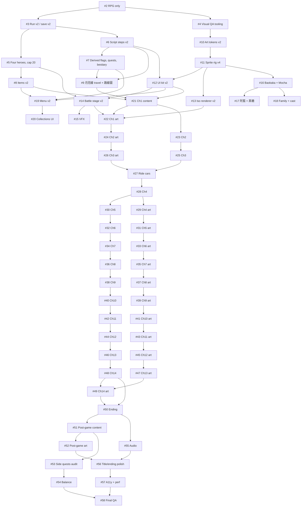

# Roadmap — 寶咖咖抓周大冒險

Tracking epic: **[#1 Epic: 寶咖咖抓周大冒險 — redesign](https://github.com/sean1093/baokaka-adventure/issues/1)**

Planning docs (story bible, script, art direction, this plan) merged in [PR #59](https://github.com/sean1093/baokaka-adventure/pull/59).

Work the issues **in numeric order**; an issue may start only when every issue in its "Depends on" column is closed. Update the **Status** column when you pick up (`in progress`) and when you merge (`done`, with the PR number). Status values: `todo`, `in progress`, `done (#PR)`, `blocked (reason)`.

## Milestones

| Milestone | Goal | Issues | Exit criteria |
|---|---|---|---|
| **M0 · Groundwork** | One game, a clean save format, and a visual QA loop every later PR can use | #2–#4 | Site boots into the RPG title; old saves reset with a friendly notice; `scripts/visual-check.mjs` produces 390×844 screenshots |
| **M1 · Engine foundations** | Every mechanic the story needs (bible § 3, § 3.1, § 3.2) exists as a tested pure function, still running the old content | #5–#9 | Four heroes, cap 20, new script steps, derived flags/quests/bestiary data, item catalogue v2, 月亮線 travel + 路線圖 screen; `npm test` green |
| **M2 · Art & UI foundations** | Option D look: tokens, rig, UI kit, iso renderer, battle stage, VFX, the heroes and recurring cast, menus and collections | #10–#20 | Art lab shows all heroes/cast at map, battle and portrait LOD; screens restyled; screenshots attached |
| **M3 · Story chapters** | The 14 chapters, the MRT ride cars and the ending, one reviewable PR at a time (content, then art, per chapter) | #21–#50 | The game is playable from the prologue to the ending; every chapter's sim fights pass |
| **M4 · Completion** | Post-game, cross-chapter side quests, balance and audio | #51–#55 | All side quests completable (tested), sim targets met, music per hour and MRT audio |
| **M5 · Polish & launch** | Title/ending polish, accessibility & performance, final QA | #56–#58 | Perf and a11y budgets met, zero placeholder sprites, full playthrough checklist signed off |

## Ordered issue list

| # | Title | Labels | Depends on | Status |
|---|---|---|---|---|
| 1 | Epic: 寶咖咖抓周大冒險 — redesign | epic | — | open |
| **M0** | | | | |
| 2 | Make the RPG the only game (remove hub, 找找看, 圖案數獨) | chore | — | done (#60) |
| 3 | Run v2: 銅板 currency, new terminology, save format v2 with a friendly reset | engine | #2 | done (#61) |
| 4 | Visual QA tooling: dev art lab route and Playwright screenshots at 390×844 | chore, qa, art | #2 | todo |
| **M1** | | | | |
| 5 | Four-hero party (寶咖咖, 摩卡貓, 阿藍, 黑糖), new skills, level cap 20 | engine | #3 | todo |
| 6 | Script steps v2: chapter clock, choice, heal ratio, free inn, spending coins, two-phase boss retry | engine | #3 | todo |
| 7 | Derived flags, quest log data, bestiary tracking and escort followers | engine | #6 | todo |
| 8 | Item catalogue v2 and hero-only equipment | engine | #5 | todo |
| 9 | 月亮線 travel: travel step, STATIONS table, @rideTo exits and the 路線圖 screen | engine, ui, mrt | #6, #7 | todo |
| **M2** | | | | |
| 10 | Art tokens v2: option D palette, per-hour night grades, fonts, Tailwind theme | art, ui | #4 | todo |
| 11 | Sprite rig contract v4: parts, LOD, shared defs, unique ids, placeholder sprite, sprite lint | art | #10 | todo |
| 12 | UI kit v2: panels, buttons, bars, dialogue with bust portrait, chapter card with clock, command panel | ui, art | #6, #11 | todo |
| 13 | Iso map renderer v2: single-SVG ground, materials, night lighting, sky layer, light sources | art | #11 | todo |
| 14 | Battle stage v2: backdrop system, four-hero layout, 布袋戲 boss frame | art, ui | #5, #12 | todo |
| 15 | Battle VFX refresh for the new skills and tone | art | #14 | todo |
| 16 | Heroes I: 寶咖咖 and 摩卡貓 (map, battle, portrait; expressions; poses) | art | #11 | todo |
| 17 | Heroes II: 阿藍 and 黑糖 | art | #16 | todo |
| 18 | Family and recurring cast: 媽媽/爸爸/阿嬤, 阿伯 ×14 + 土地公, 店員小哥, 廣播姊姊, 背包客, 咻咻 | art | #16 | todo |
| 19 | Menu v2: 抓周盤 tray, 任務 log, party, items and equipment tabs | ui | #7, #8, #12 | todo |
| 20 | Collections UI: 集章本, 長輩圖, 咻咻的回音, 月亮線乘客, 圖鑑 | ui | #19 | todo |
| **M3** | | | | |
| 21 | Ch1 content: 度晬前一晚 — home and 大安森林公園 (replaces the old story) | content, chapter-1 | #5–#9, #12 | todo |
| 22 | Ch1 art: home, 大安森林公園, Ch1 foes and NPCs | art, chapter-1 | #13, #14, #21 | todo |
| 23 | Ch2 content: 椰林大道的藍教授 — 台大 and 總圖 | content, chapter-2 | #21 | todo |
| 24 | Ch2 art: 台大, 總圖, Ch2 foes and NPCs | art, chapter-2 | #22, #23 | todo |
| 25 | Ch3 content: 月亮線，出發！ — 台北車站 and 地下街 | content, chapter-3, mrt | #23 | todo |
| 26 | Ch3 art: 台北車站, 地下街, Ch3 foes and NPCs | art, chapter-3 | #24, #25 | todo |
| 27 | 月亮線 ride cars: five cars, passengers, car fights, announcements | content, art, mrt | #25, #26 | todo |
| 28 | Ch4 content: 紅樓的走音天王 — 西門町 | content, chapter-4 | #27 | todo |
| 29 | Ch4 art: 西門町 (neon), Ch4 foes and NPCs | art, chapter-4 | #28 | todo |
| 30 | Ch5 content: 月亮票不見了 — 龍山寺 and 剝皮寮 | content, chapter-5 | #28 | todo |
| 31 | Ch5 art: 龍山寺, 青草巷, 剝皮寮, Ch5 foes and NPCs | art, chapter-5 | #29, #30 | todo |
| 32 | Ch6 content: 迪化街的布龍 — 大稻埕 and 永樂市場 | content, chapter-6 | #30 | todo |
| 33 | Ch6 art: 大稻埕, 永樂市場, Ch6 foes and NPCs | art, chapter-6 | #31, #32 | todo |
| 34 | Ch7 content: 夜市大胃王 — 士林夜市 and 地下美食區 | content, chapter-7 | #32 | todo |
| 35 | Ch7 art: 士林夜市 (neon), 美食區, Ch7 foes and NPCs | art, chapter-7 | #33, #34 | todo |
| 36 | Ch8 content: 飛機睡著的時候 — 松山機場 | content, chapter-8 | #34 | todo |
| 37 | Ch8 art: 松山機場, Ch8 foes and NPCs | art, chapter-8 | #35, #36 | todo |
| 38 | Ch9 content: 貓空上的月亮熊 — 動物園 and 貓空 (黑糖 joins) | content, chapter-9 | #36 | todo |
| 39 | Ch9 art: 動物園, 貓空, Ch9 foes and NPCs | art, chapter-9 | #37, #38 | todo |
| 40 | Ch10 content: 天鵝船的燈塔 — 碧潭 | content, chapter-10 | #38 | todo |
| 41 | Ch10 art: 碧潭, Ch10 foes and NPCs | art, chapter-10 | #39, #40 | todo |
| 42 | Ch11 content: 北投的熱呼呼 — 北投溫泉 | content, chapter-11 | #40 | todo |
| 43 | Ch11 art: 北投, Ch11 foes and NPCs | art, chapter-11 | #41, #42 | todo |
| 44 | Ch12 content: 霧裡的大水牛 — 陽明山 and 擎天崗 | content, chapter-12 | #42 | todo |
| 45 | Ch12 art: 陽明山, 擎天崗, Ch12 foes and NPCs | art, chapter-12 | #43, #44 | todo |
| 46 | Ch13 content: 河的盡頭是海 — 淡水 and 漁人碼頭 | content, chapter-13 | #44 | todo |
| 47 | Ch13 art: 淡水, 漁人碼頭, 淡江大橋 backdrop, Ch13 foes and NPCs | art, chapter-13 | #45, #46 | todo |
| 48 | Ch14 content: 離天空最近的地方 — 信義, 101 89F and the summit | content, chapter-14 | #46 | todo |
| 49 | Ch14 art: 101, the summit, 咻咻 boss forms, Ch14 foes | art, chapter-14 | #47, #48 | todo |
| 50 | Ending and post-credits: 度晬, credits, 土地公 reveal | content, art | #48, #49 | todo |
| **M4** | | | | |
| 51 | Post-game content: 象山, 生日加碼賽, 老朋友擂台, quiz, completion rewards | content, post-game | #50 | todo |
| 52 | Post-game art: 象山 at sunrise, 生日加碼・咻咻, night summit | art, post-game | #51 | todo |
| 53 | Cross-chapter side quests and collections: wiring audit and completability tests | content, engine | #51 | todo |
| 54 | Balance pass: 14 chapters, cap 20, sim targets | balance, engine | #53 | todo |
| 55 | Audio refresh: music per hour, boss stage, MRT chimes and jingles | audio | #50 | todo |
| **M5** | | | | |
| 56 | Title screen, transitions and ending polish | ui, art | #52, #55 | todo |
| 57 | Accessibility and performance pass | qa, ui | #56 | todo |
| 58 | Final QA, docs and launch | qa, docs | #54, #57 | todo |

## Dependency graph

(Each chapter's art issue also depends on its own content issue; those edges are listed in the table and omitted from the graph for readability.)
