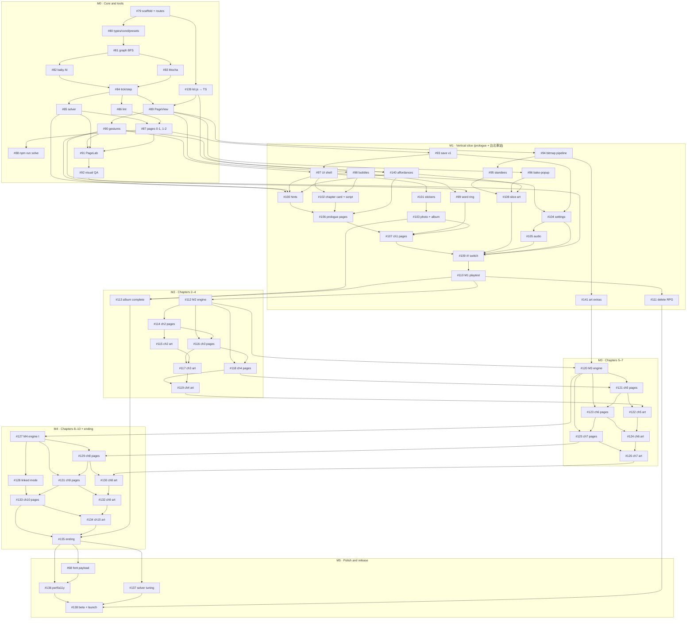
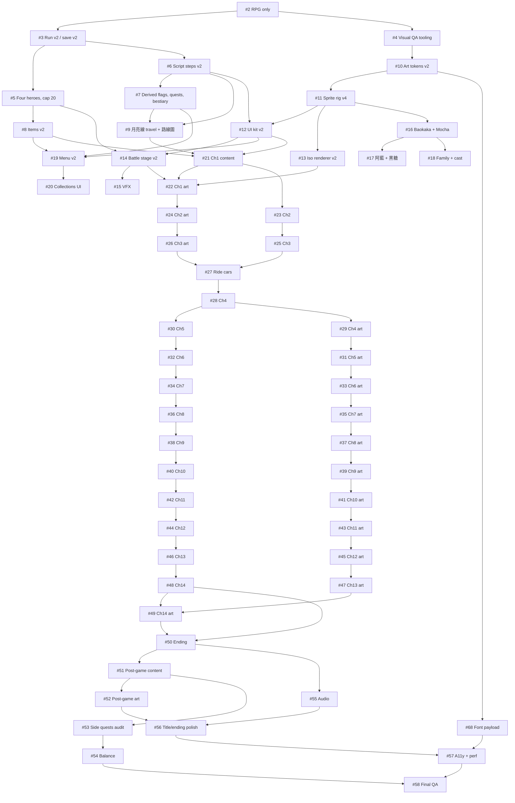

# Roadmap — 《翻翻台北》 Pop-Up Taipei

Tracking epic: **[#78 Epic: 《翻翻台北》 Pop-Up Taipei](https://github.com/sean1093/baokaka-adventure/issues/78)**

Source of truth: [`docs/design/gdd.md`](../design/gdd.md) (§7 *Milestones and issue breakdown* is the basis of this plan), [`docs/art/v2/README.md`](../art/v2/README.md) (characters) and [`docs/art/popup/README.md`](../art/popup/README.md) (environment, UI frame, motion). The plan was rebuilt on 2026-10-19 when the owner pivoted from the RPG (decisions D-34–D-38); the old plan is kept below under *Superseded plan*.

Work the issues **in the order of the table below** (it is not numeric: #139–#141 and #68 were slotted in where they belong). An issue may start only when every issue in its "Depends on" column is closed. Update the **Status** column when you pick up (`in progress`) and when you merge (`done (#PR)`). Status values: `todo`, `in progress`, `done (#PR)`, `blocked (reason)`.

## Milestones

| Milestone | Goal | Estimate (GDD §7) | Exit criteria |
|---|---|---|---|
| **M0 · Core and tools** | The pure simulation, the solver as a test, PageLab, and pages that already look like paper (kit port) | ≈ 2 w | Pages 0-1 and 1-2 playable with the kit placeholder art; `pages.test.ts` proves them in CI; PageLab and the popup visual QA targets work |
| **M1 · Vertical slice** | Prologue + 台北車站 (10 pages + the spread photo) with v2 character bitmaps, pop-up art, the full UI shell, hints, save, settings and audio; `#/` switches to the new game | ≈ 4 w | Playtest with ≥ 1 grandparent, 1 child (4–8) and 2 parents, GDD §8 gates recorded, owner go/no-go. After sign-off the old RPG is deleted (#111). **Go/no-go point for M2–M5** |
| **M2 · Chapters 2–4** | 大安森林公園, 台大, 西門町; words 掰掰 / 不要！ / 哇！; album complete | ≈ 4 w | 18 pages solver-green with final art |
| **M3 · Chapters 5–7** | 士林夜市, 松山機場, 貓空; carriers, loops, 抱抱 / 飛機！, climbing | ≈ 4 w | 18 pages solver-green with final art |
| **M4 · Chapters 8–10 + ending** | 北投, 淡水, 101; 咻——, standing, linked mode and first steps; page E, credits, bonus page | ≈ 5 w | The whole game playable from the cover to the post-credits |
| **M5 · Polish and release** | Font payload, perf/a11y gates, full solver tuning, family beta, launch | ≈ 2 w | GDD §8 technical gates met, zero placeholder art keys, owner sign-off |

## Ordered issue list

| # | Title | Labels | Depends on | Status |
|---|---|---|---|---|
| **M0 · Core and tools** | | | | |
| [79](https://github.com/sean1093/baokaka-adventure/issues/79) | Scaffold src/popup/, the #/popup route and the dev-only #/pagelab route | chore, engine, m0 | — | todo |
| [139](https://github.com/sean1093/baokaka-adventure/issues/139) | Port the pop-up art kit (docs/art/popup/src/kit.js) to TypeScript under src/popup/art/ as default placeholder art | art, ui, m0 | #79 | todo |
| [80](https://github.com/sean1093/baokaka-adventure/issues/80) | Core types, conditions and part presets (src/popup/core/types.ts, cond.ts, presets.ts) | engine, m0 | #79 | todo |
| [81](https://github.com/sean1093/baokaka-adventure/issues/81) | Walk graph: BFS, reach sets and distance tie-breaks (core/graph.ts) | engine, m0 | #80 | todo |
| [82](https://github.com/sean1093/baokaka-adventure/issues/82) | Baokaka's decision loop: desires, targets, reaching, looking and crying (core/baby.ts) | engine, m0 | #81 | todo |
| [83](https://github.com/sean1093/baokaka-adventure/issues/83) | Mocha: perch pathing, arrival actions (push, onPart, set, flee), pet and cat rules (core/mocha.ts) | engine, m0 | #81 | todo |
| [84](https://github.com/sean1093/baokaka-adventure/issues/84) | The tick: step(), event cascade, creatures, words core and ride detection (core/step.ts, events.ts, creatures.ts, words.ts) | engine, m0 | #82, #83 | todo |
| [85](https://github.com/sean1093/baokaka-adventure/issues/85) | Solver: BFS over step(), par, dead-end analysis, mischief/土地公 reachability, nextAction (core/solver.ts) | engine, m0 | #84 | todo |
| [86](https://github.com/sean1093/baokaka-adventure/issues/86) | Page lint: all GDD §3.6 rules (core/lint.ts) | engine, m0 | #84 | todo |
| [87](https://github.com/sean1093/baokaka-adventure/issues/87) | Page registry, definePage and the first pages 0-1 and 1-2 as data, with pages.test.ts | engine, content, m0 | #85, #86 | todo |
| [88](https://github.com/sean1093/baokaka-adventure/issues/88) | npm run solve: solver report for all pages (scripts/solve-pages.ts) | chore, engine, m0 | #87 | todo |
| [89](https://github.com/sean1093/baokaka-adventure/issues/89) | PageView: book frame and page renderer with the bible's z-layer table, gutter AO, V-fold crease, floor perspective, interpolation and session runner | ui, engine, m0 | #84, #139 | todo |
| [90](https://github.com/sean1093/baokaka-adventure/issues/90) | Gestures: tap, one-finger drag, magnet, snap, debounce, locked wobble and touch-pauses-the-world | ui, m0 | #89 | todo |
| [91](https://github.com/sean1093/baokaka-adventure/issues/91) | PageLab at #/pagelab: overlays, step/play, solver panel, state inspector, edit mode | chore, ui, m0 | #90, #85, #87 | todo |
| [92](https://github.com/sean1093/baokaka-adventure/issues/92) | Visual QA for 翻翻台北: PageLab fixtures, screenshot targets and UI checks for R5/R6 | chore, ui, m0 | #91 | todo |
| **M1 · Vertical slice (prologue + 台北車站)** | | | | |
| [140](https://github.com/sean1093/baokaka-adventure/issues/140) | Touchable affordance system: reserved marigold + lint, verb seals, grips, idle wiggle, hint glow/ghost-hand visuals, locked/drag states, hold-to-reveal | ui, art, engine, m1 | #139, #90 | todo |
| [93](https://github.com/sean1093/baokaka-adventure/issues/93) | Save format popup.save.v1: progress, stickers, photos, settings; discard RPG saves gracefully | engine, m1 | #87 | todo |
| [94](https://github.com/sean1093/baokaka-adventure/issues/94) | Character bitmap pipeline integration: baked frames in the build, manifest loader, animation player, mirroring, anchors | art, engine, m1 | #89 | todo |
| [95](https://github.com/sean1093/baokaka-adventure/issues/95) | Standee integration: 寶咖咖 and 摩卡 animations wired to sim modes, hop-lerp, card-flip turn, touch-watch tilt | art, ui, m1 | #94 | todo |
| [141](https://github.com/sean1093/baokaka-adventure/issues/141) | Character art extras: missing GDD §3.9 frames for 寶咖咖 (look L/R, watch-sway, ride-giggle, touch-watch, carried, climb ×3) and 摩卡 (glare, purr, in-box) | art, m1 | #94 | todo |
| [96](https://github.com/sean1093/baokaka-adventure/issues/96) | Bake pipeline scripts/bake-popup.mjs: page backdrops, parts and character frames to WebP with manifests, CI size check, and the bitmap registry | art, engine, m1 | #89 | todo |
| [97](https://github.com/sean1093/baokaka-adventure/issues/97) | UI shell: cover on the quilt, book frame, HUD label, bottom bar, page fold and chapter turn (proof C), 目錄 (ch0–1), 左手模式 | ui, m1 | #93, #90 | todo |
| [98](https://github.com/sean1093/baokaka-adventure/issues/98) | Thought bubble with change-of-mind animation, barks, subtitle bubbles and narration strips | ui, m1 | #89 | todo |
| [99](https://github.com/sean1093/baokaka-adventure/issues/99) | Word ring, word cards, learn beat, Mocha's translations and the 嗶！ first-use tutorial | ui, engine, m1 | #98, #90 | todo |
| [100](https://github.com/sean1093/baokaka-adventure/issues/100) | Hint system via the solver: levels 0–3, hint worker, ghost hand, 「等等看」 | engine, ui, m1 | #85, #90, #97, #140 | todo |
| [101](https://github.com/sean1093/baokaka-adventure/issues/101) | Page completion, sticker card, 淘氣 detection and 土地公 tap | ui, engine, m1 | #97 | todo |
| [102](https://github.com/sean1093/baokaka-adventure/issues/102) | Chapter card (departure board) and all prologue + chapter 1 lines in content/script.ts | ui, content, m1 | #97, #98 | todo |
| [103](https://github.com/sean1093/baokaka-adventure/issues/103) | Chapter spread, photo moment and the album page (chapter 1 comments) | ui, m1 | #101 | todo |
| [104](https://github.com/sean1093/baokaka-adventure/issues/104) | Settings, including 長輩模式 (grandparent mode), 大字, speed, auto-hint, sound, vibration, reduced motion, 左手模式 | ui, m1 | #97, #93 | todo |
| [105](https://github.com/sean1093/baokaka-adventure/issues/105) | Audio: extend src/shared/audio.ts with the §2.12 cues and a music-box loop for chapters 0–1 | audio, m1 | #104 | todo |
| [106](https://github.com/sean1093/baokaka-adventure/issues/106) | Prologue pages 0-2, 0-3, 0-4 as data, with scripted tutorials — all green in the solver | content, m1 | #100, #102, #140 | todo |
| [107](https://github.com/sean1093/baokaka-adventure/issues/107) | Chapter 1 pages 1-1, 1-3, 1-4, 1-5, 1-6 (台北車站) as data — all green in the solver | content, m1 | #106, #99, #103 | todo |
| [108](https://github.com/sean1093/baokaka-adventure/issues/108) | Vertical-slice art: prologue + 台北車站 (all 10 pages), cover and ch0–1 creatures/cast in the pop-up style | art, content, m1 | #95, #96, #140 | todo |
| [109](https://github.com/sean1093/baokaka-adventure/issues/109) | Routing switch: #/ boots into 翻翻台北; the RPG stays in the repo unrouted; deployment checks | chore, m1 | #107, #108, #105, #104, #92 | todo |
| [110](https://github.com/sean1093/baokaka-adventure/issues/110) | Playtest kit and the M1 playtest: checklist, observation sheet, metrics, owner sign-off | docs, qa, m1 | #109 | todo |
| [111](https://github.com/sean1093/baokaka-adventure/issues/111) | Delete the old RPG after M1 sign-off: src/quest, RPG-only art, art lab sections, sim script and baselines | chore, m1 | #110 | todo |
| **M2 · Chapters 2–4** | | | | |
| [112](https://github.com/sean1093/baokaka-adventure/issues/112) | M2 engine: light attractors with nodeBy, creatures holding items (heldBy/drop), decoys, and words 掰掰 / 不要！ / 哇！ | engine, ui, m2 | #110 | todo |
| [113](https://github.com/sean1093/baokaka-adventure/issues/113) | Album complete (multi-chapter, retake, 淘氣大王 cover) and 目錄 for all chapters | ui, m2 | #103, #110 | todo |
| [114](https://github.com/sean1093/baokaka-adventure/issues/114) | Chapter 2 pages: 「會揮手的公園」 大安森林公園 — full specs, then data for 2-1…2-6, solver-green | content, m2 | #112 | todo |
| [115](https://github.com/sean1093/baokaka-adventure/issues/115) | Chapter 2 art: 大安森林公園 pop-up pages, parts, creatures, 土地公 (斗笠 + 掃把) and the 畫筆 photo | art, content, m2 | #114 | todo |
| [116](https://github.com/sean1093/baokaka-adventure/issues/116) | Chapter 3 pages: 「醉月湖的鵝」 台灣大學 — full specs, then data for 3-1…3-6, solver-green | content, m2 | #112, #114 | todo |
| [117](https://github.com/sean1093/baokaka-adventure/issues/117) | Chapter 3 art: 台灣大學 pop-up pages, parts, creatures, 土地公 (藍色校工帽) and the 書 photo | art, content, m2 | #116, #115 | todo |
| [118](https://github.com/sean1093/baokaka-adventure/issues/118) | Chapter 4 pages: 「霓虹燈睡著了」 西門町 — full specs, then data for 4-1…4-6, solver-green | content, m2 | #112, #116 | todo |
| [119](https://github.com/sean1093/baokaka-adventure/issues/119) | Chapter 4 art: 西門町 pop-up pages, parts, creatures, 土地公 (算命墨鏡) and the 麥克風 photo | art, content, m2 | #118, #117 | todo |
| **M3 · Chapters 5–7** | | | | |
| [120](https://github.com/sean1093/baokaka-adventure/issues/120) | M3 engine: carrier, loop with crank, counterweight lift, words 抱抱 / 飛機！ and growth 爬樓梯 (climb) | engine, art, m3 | #112, #141 | todo |
| [121](https://github.com/sean1093/baokaka-adventure/issues/121) | Chapter 5 pages: 「夜市抱抱」 士林夜市 — full specs, then data for 5-1…5-6, solver-green | content, m3 | #120, #118 | todo |
| [122](https://github.com/sean1093/baokaka-adventure/issues/122) | Chapter 5 art: 士林夜市 pop-up pages, parts, creatures, 土地公 (鴨舌帽) and the 蔥 photo | art, content, m3 | #121, #119 | todo |
| [123](https://github.com/sean1093/baokaka-adventure/issues/123) | Chapter 6 pages: 「飛機睡著的時候」 松山機場 — full specs, then data for 6-1…6-6, solver-green | content, m3 | #120, #121 | todo |
| [124](https://github.com/sean1093/baokaka-adventure/issues/124) | Chapter 6 art: 松山機場 pop-up pages, parts, creatures, 土地公 (機場背心) and the 印章 photo | art, content, m3 | #123, #122 | todo |
| [125](https://github.com/sean1093/baokaka-adventure/issues/125) | Chapter 7 pages: 「纜車上的月亮」 貓空 (動物園 → 纜車 → 茶園) — full specs, then data for 7-1…7-6, solver-green | content, m3 | #120, #123 | todo |
| [126](https://github.com/sean1093/baokaka-adventure/issues/126) | Chapter 7 art: 貓空 (動物園 → 纜車 → 茶園) pop-up pages, parts, creatures, 土地公 (叢林帽) and the 芹菜 photo | art, content, m3 | #125, #124 | todo |
| **M4 · Chapters 8–10 + ending** | | | | |
| [127](https://github.com/sean1093/baokaka-adventure/issues/127) | M4 engine I: blowable preset with facing cone and 咻——, growth 扶著站 (cruise + reachHigh), coupled wheels | engine, art, m4 | #120 | todo |
| [128](https://github.com/sean1093/baokaka-adventure/issues/128) | M4 engine II: linked mode (一起), first steps (walk) and the lonely creature 咻咻 | engine, ui, m4 | #127 | todo |
| [129](https://github.com/sean1093/baokaka-adventure/issues/129) | Chapter 8 pages: 「熱呼呼的煙」 北投 — full specs, then data for 8-1…8-6, solver-green | content, m4 | #127, #125 | todo |
| [130](https://github.com/sean1093/baokaka-adventure/issues/130) | Chapter 8 art: 北投 pop-up pages, parts, creatures, 土地公 (頭上一條毛巾) and the 算盤 photo | art, content, m4 | #129, #126 | todo |
| [131](https://github.com/sean1093/baokaka-adventure/issues/131) | Chapter 9 pages: 「河的盡頭是海」 淡水・漁人碼頭・淡江大橋 — full specs, then data for 9-1…9-6, solver-green | content, m4 | #127, #129 | todo |
| [132](https://github.com/sean1093/baokaka-adventure/issues/132) | Chapter 9 art: 淡水・漁人碼頭・淡江大橋 pop-up pages, parts, creatures, 土地公 (船長帽) and the 聽診器 photo | art, content, m4 | #131, #130 | todo |
| [133](https://github.com/sean1093/baokaka-adventure/issues/133) | Chapter 10 pages: 「離天空最近的地方」 台北101 — full specs, then data for 10-1…10-6, solver-green | content, m4 | #128, #131 | todo |
| [134](https://github.com/sean1093/baokaka-adventure/issues/134) | Chapter 10 art: 台北101 pop-up pages, parts, creatures, 土地公 (清潔帽) and the 金鎖片 photo | art, content, m4 | #133, #132 | todo |
| [135](https://github.com/sean1093/baokaka-adventure/issues/135) | Ending: page E 「抓周」, 05:30 home scene, credits over album photos, post-credits 土地公, bonus page 「象山的日出」 | content, art, ui, m4 | #133, #134, #113 | todo |
| **M5 · Polish and release** | | | | |
| [68](https://github.com/sean1093/baokaka-adventure/issues/68) | Font payload: cut the CJK web-font download (self-hosted subset or text= subsetting) | qa, ui, chore, m5 | #135 | todo |
| [136](https://github.com/sean1093/baokaka-adventure/issues/136) | Performance, reduced-motion and accessibility audit for 翻翻台北 (supersedes #57) | chore, ui, m5 | #135, #68 | todo |
| [137](https://github.com/sean1093/baokaka-adventure/issues/137) | Full-game solver run, difficulty-curve review and par tuning | engine, content, m5 | #135 | todo |
| [138](https://github.com/sean1093/baokaka-adventure/issues/138) | Family beta, final QA checklist, docs and launch (supersedes #58) | docs, qa, m5 | #136, #137, #111 | todo |

## Dependency graph

---

## Superseded plan: 寶咖咖抓周大冒險 (RPG), 2026-10-18 → 2026-10-19

The RPG plan (epic #1, issues #2–#58 and #68). #2–#16 were done; the rest was closed on 2026-10-19 (D-38). Click to expand.

Tracking epic was [#1](https://github.com/sean1093/baokaka-adventure/issues/1); planning docs merged in [PR #59](https://github.com/sean1093/baokaka-adventure/pull/59). The RPG code (`src/quest/`, option-D art in `src/art/`) stays in the repo unrouted until the new game's M1 sign-off, then #111 deletes it.

#### Old milestones

| Milestone | Goal | Issues | Exit criteria |
|---|---|---|---|
| **M0 · Groundwork** | One game, a clean save format, and a visual QA loop every later PR can use | #2–#4 | Site boots into the RPG title; old saves reset with a friendly notice; `scripts/visual-check.mjs` produces 390×844 screenshots |
| **M1 · Engine foundations** | Every mechanic the story needs (bible § 3, § 3.1, § 3.2) exists as a tested pure function, still running the old content | #5–#9 | Four heroes, cap 20, new script steps, derived flags/quests/bestiary data, item catalogue v2, 月亮線 travel + 路線圖 screen; `npm test` green |
| **M2 · Art & UI foundations** | Option D look: tokens, rig, UI kit, iso renderer, battle stage, VFX, the heroes and recurring cast, menus and collections | #10–#20 | Art lab shows all heroes/cast at map, battle and portrait LOD; screens restyled; screenshots attached |
| **M3 · Story chapters** | The 14 chapters, the MRT ride cars and the ending, one reviewable PR at a time (content, then art, per chapter) | #21–#50 | The game is playable from the prologue to the ending; every chapter's sim fights pass |
| **M4 · Completion** | Post-game, cross-chapter side quests, balance and audio | #51–#55 | All side quests completable (tested), sim targets met, music per hour and MRT audio |
| **M5 · Polish & launch** | Title/ending polish, font payload, accessibility & performance, final QA | #56–#58, #68 | Perf and a11y budgets met, zero placeholder sprites, full playthrough checklist signed off |

#### Old ordered issue list

| # | Title | Labels | Depends on | Status |
|---|---|---|---|---|
| 1 | Epic: 寶咖咖抓周大冒險 — redesign | epic | — | closed — superseded by #78 |
| **M0** | | | | |
| 2 | Make the RPG the only game (remove hub, 找找看, 圖案數獨) | chore | — | done (#60) |
| 3 | Run v2: 銅板 currency, new terminology, save format v2 with a friendly reset | engine | #2 | done (#61) |
| 4 | Visual QA tooling: dev art lab route and Playwright screenshots at 390×844 | chore, qa, art | #2 | done (#62) |
| **M1** | | | | |
| 5 | Four-hero party (寶咖咖, 摩卡貓, 阿藍, 黑糖), new skills, level cap 20 | engine | #3 | done (#63) |
| 6 | Script steps v2: chapter clock, choice, heal ratio, free inn, spending coins, two-phase boss retry | engine | #3 | done (#64) |
| 7 | Derived flags, quest log data, bestiary tracking and escort followers | engine | #6 | done (#65) |
| 8 | Item catalogue v2 and hero-only equipment | engine | #5 | done (#66) |
| 9 | 月亮線 travel: travel step, STATIONS table, @rideTo exits and the 路線圖 screen | engine, ui, mrt | #6, #7 | done (#67) |
| **M2** | | | | |
| 10 | Art tokens v2: option D palette, per-hour night grades, fonts, Tailwind theme | art, ui | #4 | done (#69) |
| 11 | Sprite rig contract v4: parts, LOD, shared defs, unique ids, placeholder sprite, sprite lint | art | #10 | done (#70) |
| 12 | UI kit v2: panels, buttons, bars, dialogue with bust portrait, chapter card with clock, command panel | ui, art | #6, #11 | done (#71) |
| 13 | Iso map renderer v2: single-SVG ground, materials, night lighting, sky layer, light sources | art | #11 | done (#73) |
| 14 | Battle stage v2: backdrop system, four-hero layout, 布袋戲 boss frame | art, ui | #5, #12 | done (#74) |
| 15 | Battle VFX refresh for the new skills and tone | art | #14 | done (#75) |
| 16 | Heroes I: 寶咖咖 and 摩卡貓 (map, battle, portrait; expressions; poses) | art | #11 | done (#76) |
| 17 | Heroes II: 阿藍 and 黑糖 | art | #16 | closed — not planned (pivot) |
| 18 | Family and recurring cast: 媽媽/爸爸/阿嬤, 阿伯 ×14 + 土地公, 店員小哥, 廣播姊姊, 背包客, 咻咻 | art | #16 | closed — not planned (pivot) |
| 19 | Menu v2: 抓周盤 tray, 任務 log, party, items and equipment tabs | ui | #7, #8, #12 | closed — not planned (pivot) |
| 20 | Collections UI: 集章本, 長輩圖, 咻咻的回音, 月亮線乘客, 圖鑑 | ui | #19 | closed — not planned (pivot) |
| **M3** | | | | |
| 21 | Ch1 content: 度晬前一晚 — home and 大安森林公園 (replaces the old story) | content, chapter-1 | #5–#9, #12 | closed — not planned (pivot) |
| 22 | Ch1 art: home, 大安森林公園, Ch1 foes and NPCs | art, chapter-1 | #13, #14, #21 | closed — not planned (pivot) |
| 23 | Ch2 content: 椰林大道的藍教授 — 台大 and 總圖 | content, chapter-2 | #21 | closed — not planned (pivot) |
| 24 | Ch2 art: 台大, 總圖, Ch2 foes and NPCs | art, chapter-2 | #22, #23 | closed — not planned (pivot) |
| 25 | Ch3 content: 月亮線，出發！ — 台北車站 and 地下街 | content, chapter-3, mrt | #23 | closed — not planned (pivot) |
| 26 | Ch3 art: 台北車站, 地下街, Ch3 foes and NPCs | art, chapter-3 | #24, #25 | closed — not planned (pivot) |
| 27 | 月亮線 ride cars: five cars, passengers, car fights, announcements | content, art, mrt | #25, #26 | closed — not planned (pivot) |
| 28 | Ch4 content: 紅樓的走音天王 — 西門町 | content, chapter-4 | #27 | closed — not planned (pivot) |
| 29 | Ch4 art: 西門町 (neon), Ch4 foes and NPCs | art, chapter-4 | #28 | closed — not planned (pivot) |
| 30 | Ch5 content: 月亮票不見了 — 龍山寺 and 剝皮寮 | content, chapter-5 | #28 | closed — not planned (pivot) |
| 31 | Ch5 art: 龍山寺, 青草巷, 剝皮寮, Ch5 foes and NPCs | art, chapter-5 | #29, #30 | closed — not planned (pivot) |
| 32 | Ch6 content: 迪化街的布龍 — 大稻埕 and 永樂市場 | content, chapter-6 | #30 | closed — not planned (pivot) |
| 33 | Ch6 art: 大稻埕, 永樂市場, Ch6 foes and NPCs | art, chapter-6 | #31, #32 | closed — not planned (pivot) |
| 34 | Ch7 content: 夜市大胃王 — 士林夜市 and 地下美食區 | content, chapter-7 | #32 | closed — not planned (pivot) |
| 35 | Ch7 art: 士林夜市 (neon), 美食區, Ch7 foes and NPCs | art, chapter-7 | #33, #34 | closed — not planned (pivot) |
| 36 | Ch8 content: 飛機睡著的時候 — 松山機場 | content, chapter-8 | #34 | closed — not planned (pivot) |
| 37 | Ch8 art: 松山機場, Ch8 foes and NPCs | art, chapter-8 | #35, #36 | closed — not planned (pivot) |
| 38 | Ch9 content: 貓空上的月亮熊 — 動物園 and 貓空 (黑糖 joins) | content, chapter-9 | #36 | closed — not planned (pivot) |
| 39 | Ch9 art: 動物園, 貓空, Ch9 foes and NPCs | art, chapter-9 | #37, #38 | closed — not planned (pivot) |
| 40 | Ch10 content: 天鵝船的燈塔 — 碧潭 | content, chapter-10 | #38 | closed — not planned (pivot) |
| 41 | Ch10 art: 碧潭, Ch10 foes and NPCs | art, chapter-10 | #39, #40 | closed — not planned (pivot) |
| 42 | Ch11 content: 北投的熱呼呼 — 北投溫泉 | content, chapter-11 | #40 | closed — not planned (pivot) |
| 43 | Ch11 art: 北投, Ch11 foes and NPCs | art, chapter-11 | #41, #42 | closed — not planned (pivot) |
| 44 | Ch12 content: 霧裡的大水牛 — 陽明山 and 擎天崗 | content, chapter-12 | #42 | closed — not planned (pivot) |
| 45 | Ch12 art: 陽明山, 擎天崗, Ch12 foes and NPCs | art, chapter-12 | #43, #44 | closed — not planned (pivot) |
| 46 | Ch13 content: 河的盡頭是海 — 淡水 and 漁人碼頭 | content, chapter-13 | #44 | closed — not planned (pivot) |
| 47 | Ch13 art: 淡水, 漁人碼頭, 淡江大橋 backdrop, Ch13 foes and NPCs | art, chapter-13 | #45, #46 | closed — not planned (pivot) |
| 48 | Ch14 content: 離天空最近的地方 — 信義, 101 89F and the summit | content, chapter-14 | #46 | closed — not planned (pivot) |
| 49 | Ch14 art: 101, the summit, 咻咻 boss forms, Ch14 foes | art, chapter-14 | #47, #48 | closed — not planned (pivot) |
| 50 | Ending and post-credits: 度晬, credits, 土地公 reveal | content, art | #48, #49 | closed — not planned (pivot) |
| **M4** | | | | |
| 51 | Post-game content: 象山, 生日加碼賽, 老朋友擂台, quiz, completion rewards | content, post-game | #50 | closed — not planned (pivot) |
| 52 | Post-game art: 象山 at sunrise, 生日加碼・咻咻, night summit | art, post-game | #51 | closed — not planned (pivot) |
| 53 | Cross-chapter side quests and collections: wiring audit and completability tests | content, engine | #51 | closed — not planned (pivot) |
| 54 | Balance pass: 14 chapters, cap 20, sim targets | balance, engine | #53 | closed — not planned (pivot) |
| 55 | Audio refresh: music per hour, boss stage, MRT chimes and jingles | audio | #50 | closed — not planned (pivot) |
| **M5** | | | | |
| 56 | Title screen, transitions and ending polish | ui, art | #52, #55 | closed — not planned (pivot) |
| 68 | Font payload: cut the CJK web-font download (self-hosted subset or text= subsetting) | qa, ui | #10 | kept — moved to epic #78 (M5) |
| 57 | Accessibility and performance pass | qa, ui | #56, #68 | closed — not planned (pivot) |
| 58 | Final QA, docs and launch | qa, docs | #54, #57 | closed — not planned (pivot) |

#### Old dependency graph

(Each chapter's art issue also depends on its own content issue; those edges are listed in the table and omitted from the graph for readability.)

