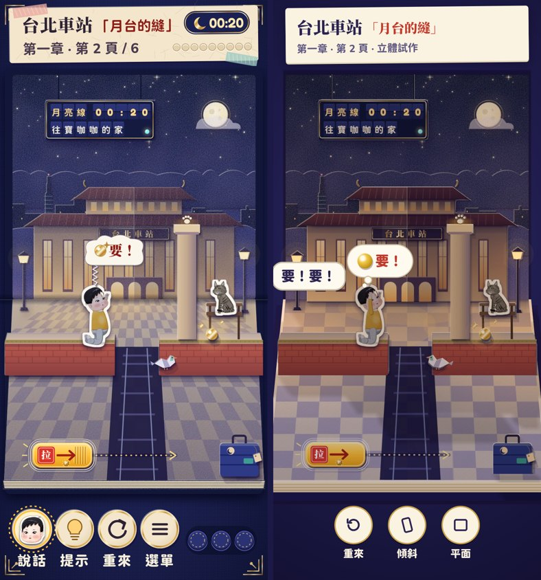
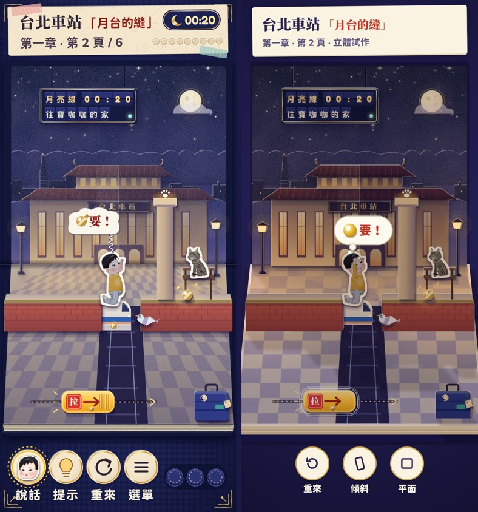
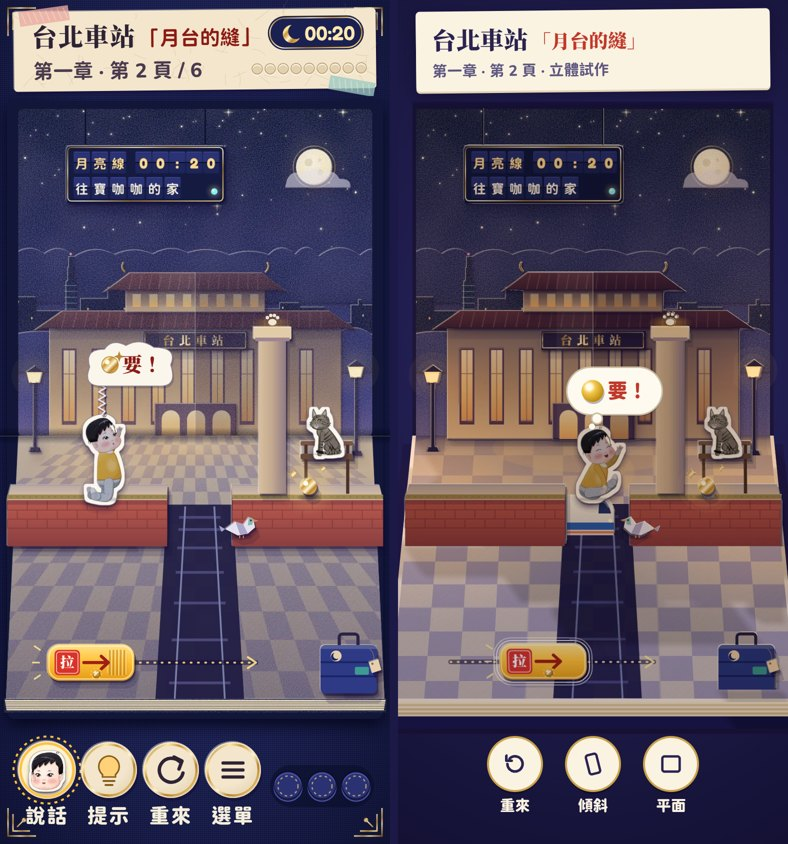
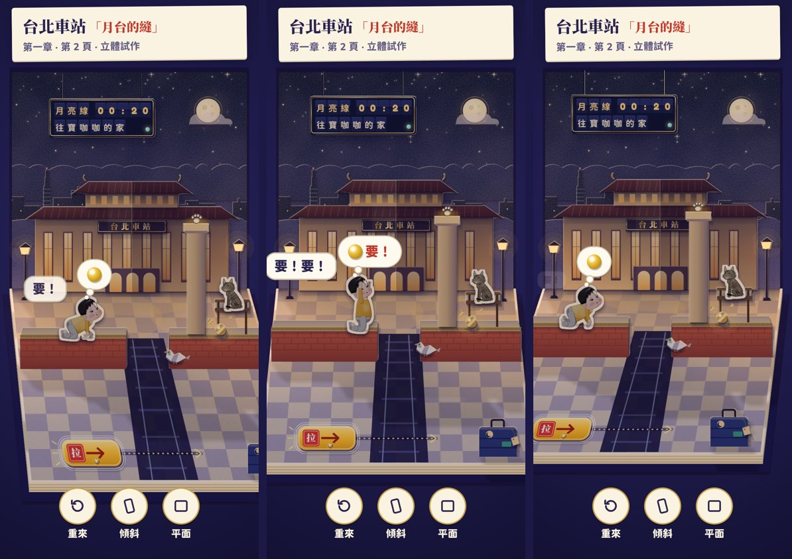
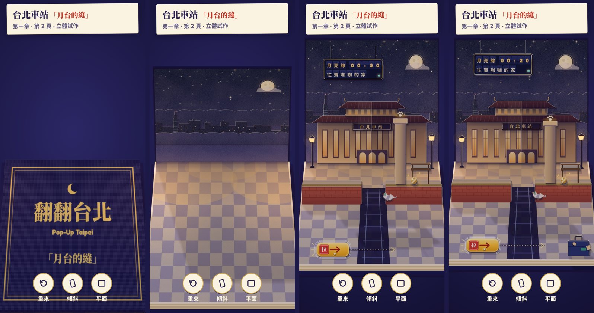

# Spike: a three.js page stage (option B) — 1-2 「月台的縫」

Issue [#225](https://github.com/sean1093/baokaka-adventure/issues/225) · decision D-110 · 2026-11-09

**Recommendation: go-with-conditions** (§ 7). The 3D page is playable on the real simulation, keeps the 2D page's layout to the pixel from its resting view, reads as a real paper pop-up when it opens and leans, and costs the game nothing until it is used. What we cannot know from this container is the one number that decides it: frame rate on a real phone GPU. That, render-on-demand and keeping the 2D renderer as the fallback are the conditions.

Try it: <https://sean1093.github.io/baokaka-adventure/popup3d.html#/popup3d?page=c1p2> (add `&fps=1` for the frame meter; on a phone, tap 傾斜 to lean the book with the gyro).

## 1. What was built

| Piece | Where | Notes |
|---|---|---|
| The route | `popup3d.html#/popup3d?page=c1p2` (dev and production) | Its own HTML entry and its own build (`vite.popup3d.config.ts`, run by `npm run build` after the game). Inside it, three.js and the stage are a lazy chunk. Params: `fps=1`, `shadows=map\|blob\|off`, `dpr=N`, `reduced=1`, `speed=`, `tilt=x,y` / `still=1` / `open=0…1` (screenshots). |
| The stage | `src/popup3d/stage.ts` | three.js r186.1 (`three@0.186.1`, pinned; released 2026-09-24). Book board and page block, the standing page hinged at the gutter (the book's cover on its back), the floor page lying flat, the crease shadow, every paper layer as a textured card with a cream cut edge just behind it, Baokaka and Mocha as standees using the baked v2 frames and the 2D page's own animation choice (`babyAnim`, `mochaState`, `chooseFrame`). |
| The camera | `src/popup3d/camera.ts` | A **window camera**: the eye looks straight down −z through the standing page with an off-axis frustum; every card is mapped along the default eye's rays, so from the resting eye each card covers exactly the pixels it covers on the 2D page, whatever its depth. Moving the eye (pointer, gyro, the opening, a slow idle breath) keeps the standing page fixed and slides each layer by its depth: true parallax with a stable frame for the DOM. Unit-tested (`camera.test.ts`). |
| The cards | `npm run bake:3d` → `src/popup3d/assets/c1p2/*.webp`, `cards.gen.ts` | 21 cards, 229 KB. The sky page, the station and the two lamps are rendered from the backdrop's own drawing functions (`env/art/c1.ts`), one card each; the floor page is drawn flat (the 3D camera paints the perspective the 2D art paints by hand); every other piece is **cut out of the 2D renderer**: `PageView` rendered to static markup at the states needed, each piece isolated in Chromium by selector and cropped to its alpha. No piece was redrawn. |
| Staging | `src/popup3d/pages3d.ts` | The only per-page authoring: each card's foot (its depth), the play plane, which plane each touchable lives on, the lamps. |
| Play | `src/popup3d/Popup3D.tsx` | `PageSession` → `step` (the real sim); `GestureTracker` (the real gesture grammar: taps, drags, rubber band, snaps, debounce, locked nopes) fed page units taken by raycasting onto the touched target's plane. The tab drags along its track lying on the floor; Mocha's paw-print perches, the board and the 土地公 take taps. |
| Text | DOM overlays | The title label, the thought bubble (what he wants, 要！), the barks, the 土地公's line, the 淘氣 / 土地公 tags and the done card are DOM, placed each frame by projecting 3D anchors (his head, Mocha's head, the 土地公). |
| Lighting | — | A warm/cool hemisphere fill, a soft fill from the reader's side, two warm lamp point lights, and **the moon behind the page as the one shadow caster** (1024² PCF shadow map; cards cast through their alpha), so each card throws its shadow forward onto the floor, where the reader sees it. `shadows=blob` swaps the map for soft contact blots. |
| Opening | — | 3.2 s: the closed book (navy cover, foil 「翻翻台北」 and the page's name) opens, the standing page swings up from the fold, the cards rise from the floor back to front with a little overshoot, then the characters pop up and the clock starts. |
| Reduced motion | — | The OS setting, the game's 減少動態 (read from the save) or `&reduced=1`: no opening (the page fades in), no lean, no idle breath, no hop arcs (the sim's reduced tween). |
| Context loss | — | `webglcontextlost` pauses the clock and shows 「紙頁重新摺好中…」; `webglcontextrestored` rebuilds the stage and play goes on from the same state; no restore within 3 s (or no WebGL at all) hands over to the 2D page (`PagePlayer`) from the same state. |
| FPS meter | `&fps=1` (`FpsMeter.tsx`) | fps, mean/worst frame time over each second, draw calls, triangles, texture MB, and the main thread's ms (stage update + render call). **For the owner to read on a phone.** |
| Checks | `npm run check:3d` (`scripts/spike3d-check.mjs`) | Touch targets, a playthrough with mouse and touch at both sizes, context loss, reduced motion; perf measurements; comparison frames and the video. |

Not ported (the spike's scope is the page stage, not the game shell): the 2D HUD (portrait, 提示, 選單, the moon clock and the tray), hints (halo, ghost hand), the word ring, sound, stickers' save, the page turn and photo moment. The overlays use the sim's data (`bubbleShow`, `barksOf`, `mischiefFired`) but simplified placement, not `layoutTalk`.

## 2. Pictures

Production build, 390×844, DPR 2. Left the 2D page (the committed visual baselines), right the 3D page at the same simulation state (the same PageLab fixture steps through the same core).

| State | 2D vs 3D |
|---|---|
| Start (3 idle ticks: he wants the bead) |  |
| Reaching (the tab at 半, he is on the train, the pigeon jams it) |  |
| Train moving (riding back) |  |
| Done (Mocha on the pillar, the bead grabbed) |  |

Leaning (eye left-up, resting, right-down) and the opening (0.12, 0.3, 0.55, 0.8 of it):





Video, 16 s (the book opens, the pointer leans it round a circle, then 1-2 is played by hand to the bead): [`07-open-lean-play.mp4`](../screenshots/225/07-open-lean-play.mp4) (0.9 MB) · [webm](../screenshots/225/07-open-lean-play.webm) (2.0 MB). Recorded in SwiftShader at a few fps, so it is choppy: the motion itself is smooth wherever there is a GPU.

**Look, honestly.** At rest it is the 2D page, slightly softer (a WebGL canvas at DPR 2 versus SVG drawn at device resolution) with real shadows under the platforms and the suitcase. Where it is clearly better is in motion: the book opening from its cover, the cards rising off the fold, and the layers separating as it leans: the station stands off the sky, the pillar and the bench off the station, the platforms and the suitcase come forward. That is the pop-up book the art bible describes and the 2D tilt (± 8 px per layer, #136) can only hint at. What it is not (yet): the cards are flat cut paper with a cream edge, not folded boxes; the platforms' tops are painted, not built; the HUD here is a placeholder.

## 3. Measurements

### 3.1 Bundle and first load

| | gzip | raw |
|---|---|---|
| The game's entry `index-*.js` | 340.33 KB, **unchanged** | 1,206.03 KB, same file hash before and after (`index-BGNslafk.js`) |
| The game's CSS | 20.54 KB, unchanged | same hash |
| `popup3d.html` + its shell `popup3d-*.js` (React, the page loader) | 0.50 + 46.4 KB | 0.8 + 143.8 KB |
| The 3D chunk `Popup3DRoute-*.js` | 383.3 KB | 1,448 KB |
| … of which three.js (the classes the stage imports, tree-shaken; esbuild, minified) | ≈ 131 KB | ≈ 538 KB |
| … of which the 2D game code it reuses (core, session, gestures, sprites and env manifests, `PagePlayer` for the fallback) | ≈ 239 KB | |
| … of which the stage, camera, route and card manifest (`src/popup3d/`) | ≈ 13 KB | |
| The 3D chunk's CSS | 4.2 KB | 18.8 KB |
| The cards (21 WebP) | 229 KB | |

**First-load impact on the game: zero.** The game's entry is byte-identical. Why a separate build: a lazy route inside the game (tried first) costs the entry +0.9 KB gzip even though no three.js byte is in it (Vite's preload helper plus the exports the lazy chunk imports back), and a second input in the same build splits shared modules into a common chunk and changes the entry. `check:prod` (first load 600 KB transferred, as at launch readiness; budgets, routes, lazy loading) passes.

Under option B for real, the 3D stage would live in the game's bundle as a lazy chunk: the increment over today is three.js (≈ 131 KB gzip) plus the stage (≈ 10–20 KB at full scope), fetched with the first page, not the cover.

### 3.2 Frame rate and frame time

Production build, 390×844, Playwright's Chromium, **WebGL on SwiftShader (software rendering on the CPU; there is no GPU in this container)**. Six seconds at rest (the idle breath moving the eye, so every frame renders), then six seconds of scripted play (the tab to 半, Mocha to the pillar).

| DPR | Shadows | CPU throttle | Rest fps (p95 frame) | Play fps (p95 / worst frame) | Main thread per frame: stage update / render call, p50 (p95) |
|---|---|---|---|---|---|
| 2 | map | 1× | 4.9 (367 ms) | 5.2 (433 / 483 ms) | 0.2 (0.5) / 1.2 (7.3) ms |
| 2 | map | 4× | 3.9 (417 ms) | 5.0 (417 / 433 ms) | 0.3 (1.8) / 4.5 (15.3) ms |
| 2 | blob | 1× | 7.9 (233 ms) | 7.9 (250 / 367 ms) | 0.2 (0.5) / 0.9 (3.9) ms |
| 2 | blob | 4× | 5.8 (433 ms) | 6.4 (317 / 317 ms) | 0.2 (2.0) / 3.1 (9.6) ms |
| 1 | map | 1× | 17.3 (100 ms) | 17.7 (100 / 133 ms) | 0.1 (0.3) / 1.0 (2.4) ms |
| 1 | map | 4× | 14.2 (133 ms) | 12.8 (167 / 167 ms) | 0.2 (1.7) / 3.8 (12.7) ms |
| 1 | off | 4× | 19.8 (83 ms) | 19.8 (83 / 150 ms) | 0.4 (1.9) / 3.2 (8.7) ms |

How to read it:
- **The software rasteriser is the bottleneck, not our code.** Frame rate scales with pixels (DPR 1 → 2 is 4× the pixels, ≈ 3.5× slower) and with the shadow pass, and barely with the CPU throttle (the throttle slows the page's main thread, while SwiftShader draws in the GPU process). The same machine draws the 2D page at 57–60 fps (`check:perf`), because Chromium's 2D path is built for exactly that. **These fps are not a prediction for a phone.**
- **What does transfer is the main thread's cost**: the stage's per-frame update is 0.1–0.4 ms (p95 ≤ 2 ms at 4× throttle) and the render call 1–4.5 ms. On a 2021 mid-range phone (roughly a 4× throttle of this machine) that leaves most of a 16.7 ms frame for the GPU.
- **The GPU load is small in geometry and large in fill**: ≈ 60 draw calls, ≈ 570 triangles, but every card is an alpha-blended plane and the sky and floor cover the screen; at DPR 2–3 with MSAA and a shadow map that is the cost a phone GPU pays. Mid-range phone GPUs handle a few full-screen blended layers at 60 fps comfortably; low-end ones at DPR 3 may not. Hence condition 1 below.
- **Real-phone GPU numbers must come from the owner**: open the link with `&fps=1` on the 2021 Android and the iPhone of the device pass, let the page sit 10 s, play it once, and note the fps line; try `&shadows=blob` and `&dpr=1.5` if it is under 50.

### 3.3 Memory, draw calls, triangles

| | 3D page | 2D page (for scale) |
|---|---|---|
| Card textures (decoded RGBA, no mipmaps) | 7.9 MB (sky 2.1, floor 2.3, station 1.1, the rest small) | backdrop 4.7 MB + board 0.4 MB (the same art, one bitmap) |
| Character frames (streamed as first used) | +1.5–2 MB after a playthrough | the same frames |
| Total texture memory reported | 9.6–10.1 MB | — |
| Shadow map | 4 MB (1024², RGBA) — 0 with `blob` / `off` | — |
| Framebuffer at 390×844, DPR 2, 4× MSAA | ≈ 47 MB (1.32 M px × 4 samples × colour + depth, plus the resolved buffer); ≈ 11 MB without MSAA | — |
| Draw calls | 60 (map), 51 (blob), 44 (off) | — (DOM/SVG) |
| Triangles | 528–570 | — |

Mipmaps are off on purpose (cards draw near 1:1): a third less memory and no generation on upload. Texture memory is comfortable for any phone that can open WebGL; the multisampled framebuffer, not the art, is the big item: at DPR ≥ 2 MSAA should be off (the pixels are small enough), which also cuts the fill cost.

### 3.4 Touch targets

Every touchable's effective target is its raycast hit plane, grown to ≥ 50 CSS px about its centre on its own plane, measured by projecting the plane to the screen (`__popup3d.touchables()`, checked by `check:3d` at the start, with the tab at 半, and with Mocha on the pillar):

| Touchable | 390×844 | 375×667 |
|---|---|---|
| The tab (`train`) | 162 × 51 | 118 × 50 |
| The board | 160 × 58 | 116 × 50 |
| A perch's paw prints | 50 × 50 | 50 × 50 |
| Mocha | 51 × 64 | 50 × 50 |
| Baokaka | 87 × 60 | 63 × 50 |

All ≥ 48 at both sizes, mouse and touch; the playthrough (drag the tab to 半, tap the pillar's paws, drag to the end, wait for the bead) finishes at tick 14–15 in all four runs. The rules are the 2D page's (`MIN_HIT_PX`, the magnet, the drag threshold, the debounce), because the gestures are the same `GestureTracker`; only the point it is fed comes from a raycast.

### 3.5 Context loss

Simulated with `WEBGL_lose_context`: on loss the clock stops (the tick does not advance while the notice shows); on restore the stage rebuilds (reloading its textures) and play continues from the same tick. A loss that is never restored hands over to the 2D page from the same state after 3.3 s. With no WebGL at all the 2D page is shown at once.

## 4. What it would take: the whole page stage under option B

Everything above the page stays: the HUD, menus, 目錄, album, credits, settings and all text stay DOM, and the core is untouched. The estimate is for one engineer who knows the codebase.

| Work | Days |
|---|---|
| Generalise the stage from 1-2 to any page: staging derived from `view/stage.ts` (runs → ledge cards and their feet, posts, carriages, crossings) with per-page overrides; the bake cutting every page's pieces by the same selectors | 4–6 |
| Backdrops split into layers (sky page, landmark, props) for 50+ backdrop keys: most share `standingPage` / `floorPage` / the landmark helpers, so this is a pass per chapter file, plus a flat floor per floor style (checker, terrazzo, grass, wood, water…) | 8–12 |
| The 14 part presets in 3D (tab, slider: slide; wheel, section, loop: rotate about the pivot; flap: a real fold about its hinge; gate, button, lift, pushable (fall), light (glow), blowable, carrier, prop), each with its drag/lifted/locked looks | 8–10 |
| Creatures (pigeons, geese, squirrel, crabs…), the carried / linked / walking modes, footprints, puddles, the 月亮線 window strip, fireflies, lamp glows, the grab burst and the word ring's effect ring | 6–8 |
| Talk on 3D anchors with the real `layoutTalk` (bubbles, barks, subtitles, the strip) as DOM; hints (the halo as a glow card, the ghost hand as DOM) | 4–6 |
| The page turn as a real 3D page flip, the chapter turn, the spread and the photo moment (the paper camera over a render-to-texture of the page) | 5–7 |
| Render on demand (sleep between ticks like the 2D page), DPR / MSAA / shadow tiers with the low-power switch, context loss everywhere, memory release per page | 3–4 |
| QA rework (below) | 8–12 |
| **Total** | **≈ 46–65 days (10–13 weeks)** |

**What QA would have to change**
- **Visual baselines** (774 targets): WebGL output differs by GPU and driver, so baselines must be pinned to SwiftShader in this container with a looser per-pixel tolerance, or the page stage is compared through stills with the 3D layer captured separately. Expect to re-baseline every page target once.
- **`check:ui`** reads text and hit areas from the page's SVG today (`[data-hit]`, the talk SVG). Text stays DOM (good: it gets easier), but hit areas must come from the stage's projected hit planes (`touchables()`), as `check:3d` does here.
- **`check:play`** drives pointers at `[data-hit]` centres; it would ask the stage for target positions instead (92 scenarios to port, mostly mechanical).
- **`check:perf`** today gates fps and live DOM nodes in headless Chromium; for WebGL the gate becomes draw calls, triangles, texture MB and main-thread ms in CI, and frame rate on the owner's devices (SwiftShader fps are meaningless as a gate).
- **Two renderers.** The 2D page must stay as the fallback (no WebGL, lost contexts, very low-end phones, possibly reduced motion), so every page is QA'd twice unless the owner accepts WebGL-only.

## 5. Risks

1. **GPU and battery on real phones** (the main unknown). Fill-rate on a DPR-3 phone with MSAA and a shadow map; heat and battery if the page renders every frame (this spike does, for the idle breath). Mitigation: render on demand, a DPR cap of 2, blob shadows on low tiers, the existing low-power switch.
2. **Softer than SVG.** The canvas is a bitmap at DPR ≤ 2; the 2D page's vectors are sharper on a DPR-3 screen. The art is baked @2x anyway, so the difference is the cut lines and the vector parts.
3. **Two renderers to maintain**, or a WebGL-only decision.
4. **QA cost and flakiness** of WebGL screenshots (§ 4).
5. **WebGL context loss** on iOS when backgrounded or under memory pressure: handled here, must be handled on every screen with a canvas.
6. **Art pipeline**: each backdrop has to be split into layers to get the depth (the cheapest version keeps a backdrop as one standing card and still gets the floor, the platforms and the props in depth).
7. **Bundle**: +131 KB gzip of three.js on the first page (not the cover).
8. **Accessibility**: kept, because all text and controls stay DOM and the canvas is one labelled image; the risk is only if text were ever moved into WebGL (it must not be).

## 6. What the spike settled

- Option B's split holds: the sim, the solver, hints, gestures and layout maths were reused untouched; only `env/art/c1.ts` exported three helpers.
- The 2D renderer can feed the 3D one: cutting cards from `PageView`'s markup works for any piece and any state, so the art does not have to be redone.
- The window camera keeps the 2D layout and the 48 px rules exact at rest, so the HUD, overlays and QA geometry carry over.
- Zero cost to the shipping game is achievable (a separate build) for as long as it is an experiment.

## 7. Recommendation: go-with-conditions

**Go** for a v2 page stage under option B, **after launch**, on these conditions:
1. **Real-device numbers first.** The owner opens the spike with `&fps=1` on the device-pass phones (2021 mid-range Android, iPhone). Go if it holds ≥ 50 fps after the opening at the default settings, or with `shadows=blob` / `dpr=1.5`; no-go if it does not at `dpr=1.5` with blob shadows.
2. **The owner likes it on a phone**, judged from the live link and the video: the opening and the lean are the value; at rest it is the same page.
3. **Render on demand** and the tiers (DPR cap, shadow mode, MSAA) are built in from the first real page, wired to the existing low-power switch.
4. **The 2D renderer stays** as the fallback (and the reduced-motion path), and QA keeps a 2D pass, or the owner explicitly accepts WebGL-only.
5. **Scope as a v2 milestone** (≈ 10–13 weeks, § 4) that never blocks the launch, converted chapter by chapter behind a setting, with the conversion tooling (staging from `stage.ts`, the bake) done first.

If condition 1 fails, the cheaper path to most of the charm is the 2D page's own: a CSS 3D opening of the existing layers and a stronger per-layer tilt (#136's parallax) — without three.js.

## 8. Reproduce

```bash
npm run bake:3d                 # re-cut 1-2's cards (Playwright's Chromium, Python with Pillow)
npm run check:3d                # build, then targets, playthrough, context loss, reduced motion, perf, media → artifacts/spike3d/
node scripts/spike3d-check.mjs --url http://localhost:5173/baokaka-adventure/ --only play   # against a dev server
```
Dev: `npm run dev`, then `http://localhost:5173/baokaka-adventure/popup3d.html#/popup3d?page=c1p2&fps=1`.
